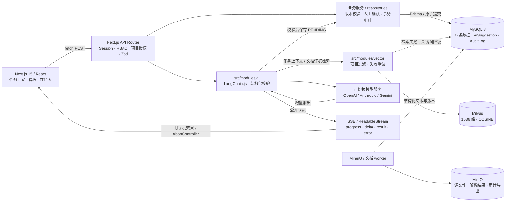

# MedPM-AI

**将医疗软件交付中的需求拆解、需求—任务—测试追溯和资源风险纳入可审计、需人工确认的工作流，减少交付决策与合规证据脱节。**

面向 FDE 的工程作品：从医疗软件项目管理约束出发，将权限、证据链、AI 不确定性和并发冲突落实为数据模型、事务边界及可复现的失败测试。全部演示与测试使用合成数据，禁止录入真实患者信息（PHI）。

## 核心架构

采用模块化单体：Next.js 承载页面与 API，业务服务负责规则和事务，AI 与向量访问分别封装。数据库事务不跨越模型、向量检索或对象存储调用。



技术栈：TypeScript strict、Next.js 15 App Router、Tailwind CSS、Prisma、MySQL、Milvus、LangChain.js、MinIO、MinerU、Vitest、Playwright、Docker Compose。Redis 为可选依赖，当前文档与风险任务使用独立 worker 和持久化任务状态。

## 关键工程决策

### GxP 导向：业务提交必须伴随证据提交

- **事务审计**：状态变更、权限调整、AI 采纳/拒绝、数据导出与对应审计同事务提交。审计失败即回滚业务写入；下载路径未成功记录导出审计，不释放文件字节。记录包含操作者、实体、before/after、IP、User-Agent 和 UTC 毫秒时间戳。
- **电子签名**：任务进入 DONE 必须重新输入当前用户密码，并从固定枚举中声明签名意图。事务内 bcrypt 校验成功后，更新任务并记录 `TASK_SIGNED_AND_COMPLETED`；密码不进入审计、日志或持久化存储。密码错误返回 401，事务超时返回可重试的 503。
- **审计不可改写**：MySQL 触发器拒绝 `AuditLog` 的行级 UPDATE 和 DELETE，保留原始历史；导出文件通过 SHA-256 验证完整性。
- **权限先于业务**：ADMIN、PM、MEMBER、QA 的 RBAC 与项目成员授权共同生效；关键写入在事务内复核角色和访问权，阻断生成期间撤权后的提交。

控制边界：触发器保护应用与常规 SQL 写入路径，不构成抵御数据库 DDL 管理员的 WORM 存储。电子签名、审计与追溯能力不等同于已完成 GxP / 21 CFR Part 11 的全系统验证。

### AI 原生：先展示预览，再提交可审核的结构化结果

| Agent | 输入与工程约束 | 输出与失败路径 |
|---|---|---|
| WBS 分解与工期预估 | 当前任务、关联需求、项目文档及历史任务实际工时；任务级拆解限制为 3–5 条 | 校验结构、依赖和引用后保存待确认建议；PM 逐条采纳才创建正式任务；模型失败提供手工创建入口 |
| 合规审计追踪 | 需求—任务—测试链路、版本和原始审计 ID；确定性规则与模型摘要分离 | 摘要和发现默认待复核，引用可追溯；模型失败保留规则结果与原始审计 |
| 资源冲突与风险预警 | 任务排期、依赖、成员跨项目周容量 | 生成待确认风险与站内通知；不自动修改排期、分配或任务状态 |

**任务级 RAG**：检索限定项目范围，保存 query、命中 ID、来源版本、耗时和降级标记。Milvus 不可用时回退 MySQL 关键词检索；向量同步失败进入 `SyncFailure`，支持受控重试。

**SSE 流式交互**：原生 `ReadableStream` 配合 LangChain `.stream()`，无需额外 AI SDK。后端将公开执行说明与最终 JSON 分段解析；前端处理 UTF-8 跨字节、事件拆包和粘包，只在收到已提交的 `result` 后展示结构化结果。预览不作为业务事实或内部推理记录。

**可取消、可恢复**：停止或关闭抽屉同时中断请求、传递模型 AbortSignal、清空打字动画队列，并隔离旧请求的迟到响应。开流前返回标准 HTTP 错误；开流后通过类型化 error 事件结束，权限变化使用 `UNAUTHORIZED` 并刷新会话。已进入提交阶段的结果通过 generationId 核对，避免将断网误认为没有保存。

### 高并发防冲突：拒绝覆盖，恢复真实状态

| 冲突场景 | 服务端约束 | 客户端恢复 |
|---|---|---|
| 多人修改排期或容量 | `expectedVersion` + 条件更新，成功后版本递增；陈旧写入返回 409 | 甘特条恢复真实位置并读取最新版本；刷新失败则暂停编辑，不自动重放写入 |
| 权限撤销与业务提交竞争 | 事务行锁、事务内权限复核，业务与审计原子提交 | 明确权限错误，刷新会话与页面权限 |
| 重复签署、采纳或审核 | 状态条件更新、事务内再次检查；拒绝已处理请求 | 提交锁与 loading 防重复；保存成功和刷新失败分别反馈 |
| 任务切换与异步响应竞争 | 请求关联生成批次；最终保存复核来源任务版本 | AbortController + 请求版本号，旧任务响应不能覆盖新抽屉 |

这些控制验证并发写入的正确性；吞吐量和延迟上限仍需按部署环境进行压力测试。

## 工程化验证：437 项单测 / 97 项 E2E 用例

验证重点是失败后系统保留什么状态，而非仅断言接口返回成功。

| 层级 | 策略与覆盖 |
|---|---|
| Vitest 单元测试 | 437 项：权限矩阵、输入与引用校验、依赖图、规则降级、SSE 任意分片、中文解码、动画清理、错误脱敏 |
| 真实 MySQL 集成测试 | 使用隔离测试库或独立合成夹具，执行真实 Prisma 事务；注入审计写入失败，验证任务完成、AI 建议、权限、排期及 Session 修改整体回滚；验证并发竞争只产生一次有效提交、迁移结构回滚及审计历史保留 |
| Playwright 浏览器测试 | 97 项用例覆盖角色工作流、签名、需求追溯、甘特图 409 回退、上传/导出和请求竞态；流式专项通过合成模型协议服务，实际经过 LangChain HTTP 流、应用和 MySQL，验证增量显示、断连取消、撤权阻断及待确认落库 |

最近验证（2026-10-18）：单元测试 **437 通过**；新增流式 MySQL 集成测试 **6 通过**；全量 E2E **89 通过、8 按配置跳过**，其中 **4 项流式协议专项已由独立 runner 全部验证通过**，其余 4 项依赖未启用的文档/风险 worker。详见[流式验证记录](docs/ai-streaming.md)与[电子签名验证记录](docs/task-signatures.md)。用例规模不等于一次执行全部通过。

```bash
pnpm lint
pnpm typecheck
pnpm test
pnpm exec vitest run --config vitest.integration.config.ts
pnpm exec playwright install chromium
pnpm test:e2e
node scripts/test-ai-streaming-e2e.mjs
```

MySQL 集成测试需要本地 `DATABASE_URL`；会创建隔离数据库的套件还需要 `MYSQL_ROOT_PASSWORD`。`medpm_demo_*` 演示库受保护，E2E 和集成测试必须使用独立测试环境的 `DATABASE_URL`。HTTP 集成、全量 E2E 与流式 runner 按顺序运行，避免多个 Next.js 服务争用 `.next`。真实存储用例需要可访问 MinIO；云端解析及 worker 场景按各模块文档配置。

## 本地运行

前置条件：Node.js **20.9+**、pnpm **10.18.3**、Docker Compose。以下为“Docker 运行依赖、宿主机运行 Next.js”的开发路径。

1. 复制 `.env.example` 为 `.env`。设置 `SESSION_SECRET`、自定义数据库/MinIO 凭据及 `LOCAL_DEV_SEED_PASSWORD`（本地合成账号密码，至少 8 位）；保持 `DATABASE_URL` 与 Compose 的 MySQL 凭据一致。MinIO 自定义根凭据时同时设置 `MINIO_ROOT_USER` / `MINIO_ROOT_PASSWORD` 与客户端对应值。生成会话密钥：

   ```bash
   node -e "console.log(require('node:crypto').randomBytes(32).toString('base64url'))"
   ```

2. 启动依赖、迁移和合成数据，再启动应用：

   ```bash
   docker compose up -d mysql etcd minio minio-init milvus
   pnpm install
   pnpm db:generate
   pnpm db:deploy
   node --env-file=.env prisma/seed.mjs
   node --env-file=.env src/modules/vector/init.mjs
   pnpm dev
   ```

   seed 与向量初始化脚本显式加载 `.env`。访问 **http://localhost:4000**，用 `pm@medpm.local`、`qa@medpm.local`、`member@medpm.local` 或 `admin@medpm.local` 登录，密码为配置的合成账号密码。seed 禁止在 production 运行。

3. 启用 AI 时配置 `AI_PROVIDER`、`AI_MODEL` 及对应密钥；向量 embedding 使用 OpenAI 兼容接口并固定 1536 维，可通过 `OPENAI_BASE_URL` 和 `OPENAI_EMBEDDING_MODEL` 配置。没有模型配置时，WBS 提供手工路径，合规摘要保留规则降级。

   文档解析/索引和自动风险扫描分别在独立终端运行；MinerU 需另配云端密钥，自动风险扫描需 PM 显式启用：

   ```bash
   pnpm documents:worker
   pnpm risks:worker
   ```

容器化应用使用 `docker compose up -d --build`，入口为 **http://localhost:3000**；Compose 自动运行迁移，合成数据仍需先按上述开发步骤初始化。ADMIN 登录后访问 `/api/health` 可检查 MySQL、Milvus、MinIO；匿名健康响应仅表示应用存活。

## 设计与验证入口

- [电子签名与事务审计](docs/task-signatures.md) · [事务锁与错误边界](docs/transaction-locking.md)
- [SSE 协议、取消与权限撤销](docs/ai-streaming.md) · [文档 RAG 与证据来源](docs/document-rag.md)
- [排期、周容量与甘特图冲突恢复](docs/planning-capacity.md) · [项目授权与合规导出](docs/project-access-exports.md)
- [角色演示路径](docs/角色分模块演示流程.md) · [已知限制与历史验证](docs/known-issues.md)
