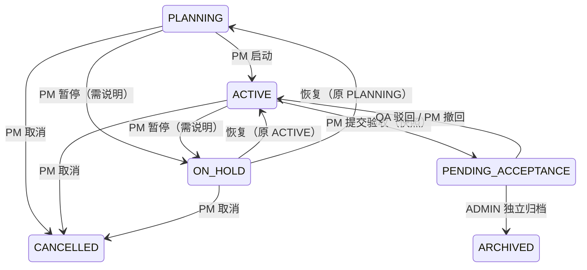
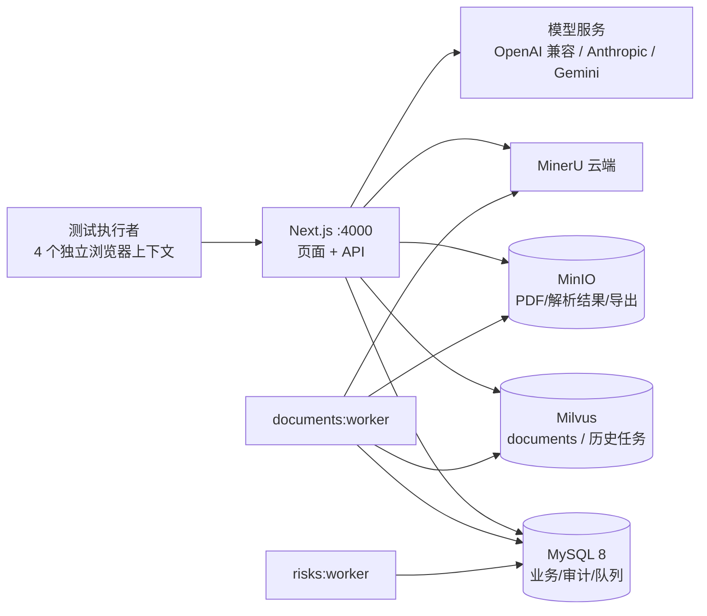

# MedPM-AI 模拟测试方案

**模拟对象**：XX市第一人民医院 EMR 系统交付项目（全合成数据）  
**方案版本**：v1.0（2026-10-20）  
**适用代码**：当前工作区 `main` 工作分支（执行前以 `git rev-parse --short HEAD` 填入）  
**配套台账**：[模拟测试执行台账](../output/test-plan/MedPM-AI-模拟测试方案-执行台账.xlsx)  
**文档状态**：待评审、待执行；文中结果字段均为空白，不代表任何用例已经通过。

| 项目 | 内容 |
| :--- | :--- |
| 测试负责人 | 待填 |
| 执行周期 | D0 准备 + D1–D4 执行（建议 5 个工作日，可压缩） |
| 用例规模 | 90 条（含 8 条故障注入），覆盖 11 个模块 |
| 自动化基线 | Vitest 单测、真实 MySQL 集成、Playwright 常规与流式专项 |
| 数据边界 | 仅合成数据；禁止真实患者信息（PHI）；演示库 `medpm_demo_*` 默认只读 |

---

## 0. 一页纸摘要

这套方案要回答的不是“接口是否返回 200”，而是：

> **一个真实医院交付项目，能否在这套系统里从执行走到归档，并在每一步留下可复核、可追溯、不可改写的证据；当依赖失败、权限被撤、两人同时操作时，系统是否仍然只产生“正确或明确失败”的状态。**

执行方式分四段：

1. **固定环境（L0/L1）**：确认依赖、迁移、快照、账号、Worker 与已知限制，再跑单测 / 真实 MySQL 集成 / 浏览器 E2E，把“不可比因素”和“代码退化”先排除。
2. **走通业务（L2）**：四个角色按真实交付顺序走完规划 → 执行 → 证据 → AI → 体检 → 验收 → 归档 → 报告。
3. **打破系统（L3）**：审计失败、模型超时、Milvus/MinIO 不可用、权限中途撤销、并发覆盖、快照篡改、归档后写入。
4. **收口证据（L4–L6）**：审计抽查与 SQL 探针、性能/安全基线、缺陷复盘与报告归档。

判定原则只有一条：**业务成功必须同时具备证据；没有证据的“成功”按失败处理。** 失败后能安全回滚、明确提示、可重试，同样计入通过。

---

## 1. 为什么需要单独的“模拟测试”

现有工程已经有较高强度的自动化：单元测试覆盖权限矩阵、规则、SSE 分片与边界；真实 MySQL 集成测试验证事务回滚与并发；Playwright 覆盖角色工作流、签名、追溯、归档冻结。它们证明的是“代码在受控夹具下正确”。

模拟测试补的是另外三件事：

| 自动化能证明 | 自动化不能证明（本方案补） |
| :--- | :--- |
| 单个接口在给定输入下返回预期状态码 | 一条跨角色、跨页面、跨异步任务的真实施工顺序能否走通 |
| 事务失败时数据库回滚 | 现场人员是否能在界面上看懂失败原因并正确恢复 |
| 夹具模型/存储协议下的行为 | 真实供应商、真实网络、真实 Worker 停摆时的降级是否可接受 |
| 已知用例的回归 | 新组合、新顺序、新对抗输入是否产生证据缺口 |

因此，**模拟测试不是自动化的重复，而是把系统放回业务上下文里做一次“交付彩排”**。自动化是准入条件；模拟测试是准出条件。

### 1.1 与现有测试资产的关系

| 资产 | 定位 | 本方案如何使用 |
| :--- | :--- | :--- |
| [全流程功能与边界测试脚本](MedPM-AI-全流程测试脚本.md) | 逐条手工验收步骤（模块 0–6） | 复用其业务步骤与判定标准；补角色分工、证据包、故障注入与准出规则 |
| [角色分模块演示流程](角色分模块演示流程.md) | 对外演示脚本 | 不作为验收依据；演示中的“通过”不能替代本方案的证据 |
| [`e2e/`](../e2e/) 与 `tests/integration/` | 自动化回归 | 作为 L1 准入门槛；台账“自动化入口”列给出映射 |
| [已知问题](known-issues.md) | 已接受限制与偶发问题 | 执行前确认 skip 范围；不把历史通过当作本轮通过 |

---

## 2. 测试目标与范围

### 2.1 目标（可度量）

| 编号 | 目标 | 度量方式 |
| :--- | :--- | :--- |
| G1 | 业务闭环可完成 | 在同一个项目上完成 ACTIVE → 体检 → 送审 → QA 批准 → ADMIN 归档，且归档后所有写入口关闭 |
| G2 | 证据闭环可信 | 关键动作审计覆盖率 100%；审计失败注入 100% 回滚；导出文件 SHA-256 与记录一致 |
| G3 | AI 输出可控 | 抽查不少于 20 条 AI 建议，100% 为 PENDING 且经人工采纳才产生正式任务/结论；引用可回溯到原始分块 |
| G4 | 权限边界可信 | 越权用例 100% 拒绝；项目级隔离无 IDOR；权限撤销后下一次写入即被拒绝 |
| G5 | 异常可恢复 | 8 类故障注入均不产生“业务成功但缺审计/缺文件/状态错乱”；恢复步骤可执行 |
| G6 | 演示环境不被污染 | 执行前后基线计数差异可解释；`medpm_demo_*` 未被测试夹具写入 |

### 2.2 范围内

- 认证、RBAC、项目级授权、项目管理、任务与排期、容量。
- 交付物、文档上传/解析、RAG 检索、电子签名。
- WBS / 合规审计 / 风险预警三个 Agent，会议 AI、SSE 流式交互。
- 结项体检、风险送审、QA 批准、归档冻结、通知。
- 合规导出（CSV/JSON）、结项报告（JSON/HTML）、PMO Dashboard。
- 异步 Worker（文档、风险）、审计与触发器、非功能（并发/性能/安全/兼容）。

### 2.3 范围外（明确不声称）

| 不做 | 原因 |
| :--- | :--- |
| 真实 PHI / 真实患者数据 | 合规红线；全部使用合成数据 |
| 真实 MinerU、真实模型供应商的 SLA 与计费验证 | 需独立联调环境；夹具通过不等于在线服务通过 |
| GxP / 21 CFR Part 11 全系统验证 | 当前实现是“可审计、可追溯、需确认”的工程能力，不是法规认证 |
| 生产级压力测试与容量规划 | 本方案只建立本地基线；吞吐/延迟需按部署环境另测 |
| 防御数据库 DDL 管理员 | 触发器可被超级权限删除，方案只验证运行时 DML 账号边界 |
| 客户 UAT 签字与真实上线 | 模拟测试是内部准出，不替代客户验收 |

---

## 3. 被测系统速览（执行者最小知识）

> 详细设计见 [项目详细说明](项目详细说明.md)、[README](../README.md) 与各模块文档。这里只保留执行时必须知道的事实。

### 3.1 角色与数据边界

| 角色 | 可做 | 不可做（必须验证） |
| :--- | :--- | :--- |
| ADMIN | 用户管理、全局审计、项目授权、最终归档、全局统计 | 不替 PM 执行业务；不得与提交人/QA 为同一账号完成审查或归档 |
| PM | 创建项目、成员授权、任务/排期/容量、AI 建议确认、提交验收 | 不能批准自己提交的交付物；无例外授权时不能带缺口送审 |
| MEMBER | 执行本人任务、更新状态、签署本人任务 | 不能上传/审批交付物、不能改他人任务、不能排期、不能看全局审计 |
| QA | 审计查看（授权项目）、合规导出、测试追溯、交付物审批、验收审查 | 不能修改任务状态、不能归档、不能看未授权项目 |
| PMO | 全局统计只读、个人会话与密码 | 无项目写入、文档访问、审批、用户管理权限 |

**数据边界**：系统角色决定“能做什么”，项目授权决定“能看/能改哪个项目的数据”。两者同时生效；加入项目不会提升系统角色。

### 3.2 项目状态机



**不可逆点**：`ARCHIVED` 没有解冻接口；`CANCELLED` 没有恢复入口。执行顺序必须先风险分支、再主线、最后归档。

### 3.3 任务状态机

`TODO / IN_PROGRESS / BLOCKED` 之间可流转；`DONE` 必须经过签名；`CANCELLED` 可从非终态取消并需原因。  
进入 `DONE` 必须提交 `actualHours`、`signaturePassword`、`signatureReason`；密码错误 401，事务超时 503，审计失败整体回滚。

### 3.4 三个 AI Agent 的边界

| Agent | 输入 | 输出 | 失败路径（必须验证） |
| :--- | :--- | :--- | :--- |
| WBS 分解 | 任务、需求、项目文档分块、历史实际工时 | 3–5 条待确认子任务建议，含引用 | 结构校验失败最多纠错 2 次；仍失败给出手工入口，不落正式任务 |
| 合规审计 | 需求—任务—测试链路、版本、审计 ID | 确定性规则发现 + 模型摘要，均待复核 | 模型失败保留规则结果；引用未知 ID 整批降级 |
| 风险预警 | 排期、依赖、跨项目周容量 | 待确认风险 + 站内通知 | 不自动改排期/分配/状态；数据超限明确报错 |

**共性不变量**：AI 只写 `AiSuggestion(PENDING)` 与生成审计；采纳是独立的人工事务；AI 调用不占数据库长事务。

### 3.5 八条不可违反的不变量

1. 业务写入与审计同事务；审计失败即业务回滚。
2. AI 输出默认 PENDING，禁止直接写入正式业务表。
3. 事务锁顺序：Project → User（UUID 排序）→ 业务记录。
4. 归档三层保护：HTTP 403、事务复核、MySQL 触发器。
5. 验收快照哈希不一致返回 409，禁止批准/归档。
6. 签名只对“当前完成轮次”有效，重开后旧签名不能复用。
7. RAG 失败降级为 MySQL 关键词检索，不阻塞主流程。
8. 所有资源访问都经项目授权；全局角色不能绕过项目隔离。

---

## 4. 测试策略

### 4.1 分层策略

| 层 | 目的 | 主要手段 | 退出条件 |
| :--- | :--- | :--- | :--- |
| L0 环境与基线 | 排除环境差异 | 健康检查、迁移状态、快照脚本、只读冒烟 | 基线计数与账号全部可复现 |
| L1 自动化回归 | 证明代码未退化 | `pnpm lint/typecheck/test`、真实 MySQL 集成、Playwright | 全绿；skip 必须登记理由，不计入通过 |
| L2 业务主线 | 证明交付闭环可完成 | 四角色手工演练（S2–S9） | 同一项目从 ACTIVE 走到 ARCHIVED |
| L3 异常与对抗 | 证明失败可控 | 故障注入、越权重放、并发竞争（S10） | 无“成功但缺证据”的状态 |
| L4 合规证据 | 证明证据可复核 | 审计查询、SQL 探针、哈希校验、证据包 | 抽查字段完整率 100% |
| L5 非功能 | 建立性能与安全基线 | 并发脚本、响应采样、注入载荷 | 达到建议门槛或有书面偏差说明 |
| L6 复盘 | 形成可复用资产 | 缺陷分析、用例修订、报告 | 报告归档、遗留风险有负责人 |

### 4.2 六类“模拟”

| 模拟类型 | 具体做法 | 代表用例 |
| :--- | :--- | :--- |
| 业务模拟 | 以真实 EMR 交付节奏组织：调研 → 蓝图 → SIT → UAT → 验收 | S3–S9 |
| 角色模拟 | 4 个账号 + PMO + 访客 + 非成员；每人固定浏览器上下文 | AUTH-01..10 |
| 故障模拟 | 审计失败、模型超时、Milvus/MinIO 停、Worker 停、P2028/P2034 | FLT-01..08 |
| 数据模拟 | 合成 PDF、会议转写、超长文本、边界/脏数据 | S5、S6、7.4 |
| 时间模拟 | UTC 与香港时区、周容量边界、月度统计边界 | TSK-08、NFR-06 |
| 对抗模拟 | 越权重放、篡改请求体、伪造 checkId、自审、XSS、公式注入 | 10.2 |

### 4.3 风险驱动的覆盖矩阵

| 风险 | 场景 | 关键用例 |
| :--- | :--- | :--- |
| R1 越权/IDOR | 换 ID、换项目、换角色重放 | AUTH-05/06/07、EXP-04 |
| R2 审计缺失或不同步 | 审计失败注入、触发器探针 | FLT-01、NFR-05、12.4 |
| R3 AI 幻觉/越界/未确认落库 | 伪造引用、模型失败、正结论拦截 | AI-02/04/06、CMP-04 |
| R4 RAG 失败阻塞主流程 | 停 Milvus、超时降级 | AI-12、FLT-04 |
| R5 并发覆盖/丢失更新 | 双 PM 保存、旧版本提交 | TSK-03、PRJ-07、NFR-01 |
| R6 撤权后仍提交 | 生成中撤权、提交前撤权 | AI-14、CMP-08、FLT-01 |
| R7 归档后仍可写 | API 重放 + SQL 直写 | ARC-05、NFR-05 |
| R8 签名轮次错配 | 重开后旧签名、时间篡改 | SIG-07、TSK-07 |
| R9 导出泄漏/损坏 | 撤权直链、哈希不符、超限 | EXP-03/04/05/07 |
| R10 时区/统计错误 | 月末、周界、空数据 | NFR-06、TSK-08 |
| R11 Worker 停摆导致悬挂 | 停 worker 观察状态 | FLT-06 |
| R12 演示数据被污染 | 基线对比、库名保护 | ENV-03/04/06 |

### 4.4 证据驱动

每条用例执行时必须产出至少一项证据，并登记到台账“证据”列：

- `png`：界面状态（含错误提示、只读态、风险标签）。
- `json`：接口响应（脱敏后）或审计查询结果。
- `log`：自动化命令输出、Worker 日志片段。
- `har`：仅在需要证明请求/响应时使用；必须脱敏 Cookie、Token、密码。

没有证据的用例只能记为“未测”，不能记为“通过”。

### 4.5 手工与自动化的分工

| 必须手工 | 可以用自动化替代 | 只做夹具验证（明确边界） |
| :--- | :--- | :--- |
| 角色协作顺序、页面提示是否可理解、失败后的恢复动作 | 权限矩阵、状态机、SSE 分片、哈希/快照、并发回滚 | 模型供应商、MinerU、MinIO/Milvus 在线可用性 |

自动化映射写在台账“自动化入口”列；**自动化通过不自动等于手工场景通过**，反之亦然。

### 4.6 用例设计与优先级

| 方法 | 在本方案中的应用 |
| :--- | :--- |
| 状态迁移 | 项目（PLANNING/ACTIVE/ON_HOLD/PENDING_ACCEPTANCE/ARCHIVED/CANCELLED）、任务、AI 建议、验收轮次；合法与非法迁移都测 |
| 边界值 | 8000 字 / 70% 上下文、20 字风险说明、0/168 小时容量、5 次登录失败、1500ms 检索预算、5000/20000/10MiB 导出上限 |
| 判定表 | 角色 × 项目授权 × 资源类型（任务/文档/交付物/会议/通知/导出/审计） |
| 故障注入 | 审计、事务、模型、Milvus、MinIO、Worker、MySQL、网络 |
| 对抗输入 | IDOR、字段篡改、重放、XSS、CSV 公式、超长/空值 |
| 并发时序 | 撤权 vs 提交、双人签署、上传/索引 vs 归档、双 PM 保存 |

| 优先级 | 定义 | 处置 |
| :--- | :--- | :--- |
| P0 | 证据错误、越权、不可逆数据错误、AI 未经确认落库 | 必须 100% 通过；失败即阻断 |
| P1 | 主流程可完成性、结果可信度、关键降级 | 目标 ≥95%；未通过需书面说明 |
| P2 | 提示、边界、体验、非关键降级 | 记录并排期；准出前有结论 |

---

## 5. 质量目标与准出标准

### 5.1 指标

| 指标 | 建议目标 | 取证方式 | 不达标处置 |
| :--- | :--- | :--- | :--- |
| P0 用例通过率 | 100% | 台账 | 阻断，修复后整场景重跑 |
| P1 用例通过率 | ≥ 95% | 台账 | 未通过项需书面偏差说明 |
| 未关闭缺陷 | P0/P1 = 0 | 缺陷表 | 不得准出 |
| 关键动作审计覆盖 | 100% | 审计抽查 20 条 | 视为 P0 |
| 审计失败回滚 | 100% | FLT-01 | 视为 P0 |
| AI 建议人工确认率 | 100% | 抽查 20 条 | 视为 P0 |
| 越权拒绝率 | 100% | AUTH/EXP | 视为 P0 |
| 导出哈希一致率 | 100% | EXP-03 | 视为 P1 |
| 演示库污染 | 0（测试夹具） | 基线对比 | 视为 P1 并重建快照 |
| 非 AI API P95 | 建议 ≤ 800 ms（本地） | 采样 50 次 | 记录基线，不作为首轮阻断 |
| 页面可交互 | 建议 ≤ 3 s（本地） | 采样 10 次 | 记录基线 |
| AI 首 token | 建议 ≤ 5 s（真实供应商） | 采样 10 次 | 记录供应商与网络条件 |
| 并发 10 用户错误率 | 0 个 5xx | NFR-01 | 出现即 P1 |

> 性能数字是**建议门槛**，不是既有承诺。首轮的价值在于建立基线；后续回归与基线对比。

### 5.2 准出硬条件（全部满足）

1. 同一项目完成 ACTIVE → 体检 → 送审 → QA 批准 → ADMIN 归档，且归档后写入口全部关闭。
2. 风险分支（带缺口送审）无法绕过 QA/ADMIN 规则；撤回/驳回后可恢复整改。
3. 归档后三层写保护均验证：HTTP 403、事务复核、SQL 触发器 `ER_ARCHIVED_PROJECT`。
4. 审计失败注入导致业务与审计整体回滚；审计 UPDATE/DELETE 被触发器拒绝。
5. 抽查 AI 建议全部为 PENDING，采纳后才产生任务/结论；引用可回溯。
6. 越权矩阵与导出直链全部拒绝；撤权后旧会话/旧页面不能继续写。
7. P0/P1 缺陷清零；P2 有修复计划或书面规避；skip 用例逐条登记。
8. 证据包完整（见 12.2），测试报告完成评审。

### 5.3 中止条件

- 演示库被测试夹具写入且无法区分来源。
- 归档后仍可通过任意路径写入，或审计可被删除/改写。
- 出现真实患者信息或密钥泄漏。
- 依赖服务连续 2 小时不可用且无替代环境。

中止后保留现场，不删库、不改触发器、不手工修数据；先出故障记录再决定重建快照。

---

## 6. 测试环境

### 6.1 拓扑



### 6.2 依赖与最低配置

| 组件 | 用途 | 检查方式 | 不可用时 |
| :--- | :--- | :--- | :--- |
| Node.js ≥ 20.9 / pnpm 10.18.3 | 运行 | `node -v`、`pnpm -v` | 阻断 |
| MySQL 8 | 业务与审计 | `GET /api/health`（ADMIN） | 阻断 |
| MinIO | 文件与导出 | 健康检查 + 上传/下载冒烟 | 上传/导出标记阻塞 |
| Milvus | 向量检索 | 健康检查 + 检索冒烟 | 允许，转 RAG 降级用例 |
| 模型服务 | AI | 一次最小生成 | 允许，转手工/降级用例 |
| MinerU | PDF 解析 | 一次解析任务 | 允许，标记阻塞；不得把预置解析当作本次成功 |
| documents:worker | 解析/分块/向量 | 队列是否推进 | 允许，标记阻塞；不得把“同步中”当“已入库” |
| risks:worker | 自动扫描 | 一轮扫描是否完成 | 允许，转手动扫描 |

### 6.3 配置基线（不写入文档的密钥）

执行前由环境负责人在本地 `.env` 确认：

- `DATABASE_URL` 指向本轮演练库；`SESSION_SECRET` 已设置且非默认值。
- `LOCAL_DEV_SEED_PASSWORD` 为本地合成密码（≥ 8 位），四个账号共用。
- `AI_PROVIDER` / `AI_MODEL` / `OPENAI_BASE_URL` / `OPENAI_EMBEDDING_MODEL` 与所选供应商一致；embedding 固定 1536 维。
- `MINIO_*` 与 `MILVUS_*` 可访问；`MYSQL_ROOT_PASSWORD` 只用于测试库创建。
- `REGISTRATION_INVITE_CODE` 仅在需要时设置；不配置时注册进入 PENDING。
- `.env` 不提交、不截图、不粘贴到缺陷单；证据中的密钥字段必须打码。

### 6.4 数据隔离与复位

| 环境 | 用途 | 规则 |
| :--- | :--- | :--- |
| `medpm_demo_*`（展示快照） | 对外演示 | 只做只读验证；仅产生登录/下载审计 |
| `medpm_demo_*`（演练快照） | 写满并归档 | 独立快照与 `.env`；允许业务写入；结束后切回展示快照 |
| `medpm_test_ia_*` | 自动化隔离库 | 由 `scripts/test-project-ia.mjs` 自动创建，测试结束保留用于回滚证据 |
| 临时故障实例 | 故障注入 | 独立库/独立进程；禁止在演示库停共享服务或改角色 |

**推荐做法（展示与演练分离）**：D0 保留当前展示快照不动，另执行一次 `prepare-hospital-demo.mjs --apply` 生成演练快照并把 `.env` 指向它；演练结束后，把 `.env` 恢复为该次运行生成的 `.env.before-demo-*`（指回展示快照）并重启服务。两套库的审计都保留，不删除。

**复位策略**：需要重演时再生成新快照；任何情况下都不删除旧库、旧审计与触发器，只切换 `.env`。

**保护机制**：Playwright 与集成测试在检测到 `DATABASE_URL` 指向 `medpm_demo_*` 时直接拒绝执行；不要绕过该保护来“省事”。

### 6.5 环境自检（ENV-01..06）

执行顺序：依赖健康 → 迁移与代码 → 快照与基线 → 只读冒烟 → Worker → 演示库保护。

| 编号 | 检查 | 通过标准 |
| :--- | :--- | :--- |
| ENV-01 | MySQL/MinIO/Milvus 健康 | ADMIN 访问 `/api/health` 全部 ok；匿名访问只表示应用存活 |
| ENV-02 | 迁移与代码基线 | `pnpm db:deploy` 无待应用迁移；`pnpm lint`、`pnpm typecheck`、`pnpm test` 全绿 |
| ENV-03 | 快照与基线计数 | 4 账号可登录；1 个项目、14 任务、6 阶段、3 交付物、3 需求、3 测试用例、1 会议、3 行动项；体检 16 个规则缺口 |
| ENV-04 | 只读冒烟 | `node scripts/verify-hospital-demo.mjs` 通过；下载字节与 SHA256 一致 |
| ENV-05 | Worker | 文档队列可推进；风险扫描可完成一轮；记录启动命令与日志位置 |
| ENV-06 | 演示库保护 | E2E/集成测试检测到 `medpm_demo_*` 时立即拒绝，不写入夹具 |

> 基线数字只在“刚复位、未做任何业务操作”时有效。一旦采纳 WBS、转行动项、完成任务，必须改用实时数量 N，不得继续按 14/16 判错。

### 6.6 并发与端口约束

- 同一 `.next` 构建目录不能同时跑 dev server、HTTP 集成测试和 Playwright；必须串行。
- Playwright 若复用已启动的 dev server（`E2E_BASE_URL`），结束后由启动方关闭；Windows 下偶发关闭卡住，准备独立终端。
- 自动化运行前确认没有手工 `pnpm dev` 占用；否则可能复用旧服务或残留进程。
- 故障注入使用独立端口/独立库，不与主线并行。

---

## 7. 模拟数据设计

### 7.1 基线数据（医院 EMR）

| 对象 | 数量/状态 | 用途 |
| :--- | :--- | :--- |
| 项目 | 1 个，ACTIVE，负责人 PM | 主线 |
| 任务 | 14 条：TODO 7、IN_PROGRESS 1、DONE 6；13 条依赖；6 个阶段 | 看板/甘特/签名 |
| 交付物 | 3 份 V1，APPROVED，独立 QA 评审，真实中文 PDF | 下载/哈希/证据 |
| 需求 | 3 条 APPROVED | 追溯/RAG |
| 测试用例 | 3 条 NOT_RUN | 追溯，不伪造通过 |
| 会议 | 1 份 FINALIZED，3 条待转任务行动项 | 会议 AI/转任务 |
| 体检缺口 | 未完成任务 8、缺交付物 5、签名缺口 0、未转行动项 3，合计 16 个规则项 | 风险分支 |

注意：16 是“规则项之和”，不是 16 个有问题的任务；同一任务可能同时缺交付物和签名。

### 7.2 身份与账号

| 代号 | 账号 | 角色 | 本轮职责 |
| :--- | :--- | :--- | :--- |
| U1 | `pm@medpm.local` | PM | 项目组织、AI 确认、提交验收 |
| U2 | `member@medpm.local` | MEMBER | 执行与签署本人任务 |
| U3 | `qa@medpm.local` | QA | 交付物审批、合规审查、导出 |
| U4 | `admin@medpm.local` | ADMIN | 用户/授权、最终归档、全局统计 |
| U5 | 临时创建 | PMO | 只读统计边界 |
| U6 | 访客 | 未登录 | 重定向与安全 next |
| U7 | 临时创建 | PM/QA 非成员 | 跨项目/越权负例 |

规则：一个角色一个浏览器上下文；不共用 Cookie；密码不进入 URL、LocalStorage、截图或抓包附件；临时账号在结束后禁用但保留审计。

### 7.3 合成材料清单

| 材料 | 来源/构造 | 用于 |
| :--- | :--- | :--- |
| 三份已批准 PDF | `output/pdf/hospital/`（实施主计划、需求规格、实施蓝图） | 下载、哈希、追溯、RAG |
| SIT 测试报告 PDF | 新建合成文档，命名“SIT 测试报告（合成演示）” | 交付物上传/审批/签名 |
| 会议转写稿 | 附录 C，纯合成、含相对日期与未定负责人 | 会议 AI、行动项 |
| 超长文本 | 附录 C 重复至 2 万字 | 413 拦截 |
| 对抗载荷 | 附录 D：XSS、CSV 公式、超长字段、伪造 UUID | 安全与校验 |
| 边界数据 | 空项目、无任务、跨项目引用、悬空 TaskId、历史会议 | 规则与降级 |

**命名规则**：所有上传文件以“合成/Synthetic”开头或结尾；禁止把真实医院文档改名后上传。

### 7.4 边界与脏数据

| 数据 | 构造方式 | 目的 | 清理 |
| :--- | :--- | :--- | :--- |
| 空项目（0 任务） | 创建空模板项目 | 验证空项目不能体检/送审 | 演练库内保留 |
| 缺日期/工时的任务 | 任务创建时留空 | 排期“待确认”池、风险规则 | 保留 |
| 跨项目 TaskId | 手工构造会议行动项 JSON（仅隔离库） | 体检规则必须识别为缺口 | 隔离库 |
| 悬空 TaskId | 同上 | 不能算“已转任务” | 隔离库 |
| 历史会议（>6 个月） | 隔离库夹具 | 行动项统计不被时间截断 | 隔离库 |
| 版本冲突数据 | 两个上下文打开同一任务 | 409 与回滚 | 正常数据 |
| 超限导出 | 隔离库构造 >5000 实体或 >10 MiB | 422 而非截断 | 隔离库 |

### 7.5 数据构造原则

1. 只通过应用、seed、准备脚本或测试夹具构造；不手写业务 SQL。
2. 不伪造电子签名、不补造历史审计、不改 `completedAt` 来“消除缺口”。
3. 不删除、不禁用审计触发器；确实需要触发器级验证时，用独立库并记录恢复步骤。
4. 所有脏数据只进隔离库；演示库只保留真实演练产生的业务数据。
5. 数据变更后立即更新基线记录（数量、UUID、时间），避免后续误判。

---

## 8. 角色、职责与排期

### 8.1 测试角色

| 角色 | 职责 | 建议人选 |
| :--- | :--- | :--- |
| 测试负责人 | 方案、排期、准出判定、对外沟通 | 你（PM/FDE） |
| 执行 A（PM 视角） | 项目、任务、AI 确认、提交验收 | 熟悉业务的人 |
| 执行 B（执行/QA 视角） | MEMBER 签署、QA 审批、导出 | 第二人，避免自己审自己 |
| 环境负责人 | 依赖、迁移、快照、Worker、故障注入 | 能操作 Docker/MySQL 的人 |
| 记录员 | 台账、截图、证据命名、缺陷登记 | 可由执行 B 兼任 |
| 观察员（可选） | 客户代言人，只提问不操作 | 同事/导师 |

**关键约束**：提交人、QA、归档 ADMIN 必须是三个不同账号；不要让同一人“自导自演”全部角色，否则职责分离用例没有意义。

### 8.2 RACI

| 活动 | 负责人 | 执行 A | 执行 B | 环境 | 记录 |
| :--- | :--- | :--- | :--- | :--- | :--- |
| 环境与快照 | 环境 | I | I | R/A | C |
| 自动化基线 | 负责人 | I | I | C | R |
| 业务主线 | 负责人 | R | R | C | C |
| 故障注入 | 环境 | C | C | R/A | C |
| 证据与报告 | 负责人 | C | C | I | R/A |
| 准出判定 | 负责人 | C | C | C | I |

> R=负责执行，A=最终负责，C=被咨询，I=知会。一人可兼多角色，但提交人、QA、归档 ADMIN 必须分属不同账号。

### 8.3 排期（建议）

| 时间 | 内容 | 产出 |
| :--- | :--- | :--- |
| D0 下午 | 方案评审、环境、快照、材料、自动化基线 | ENV-01..06 记录；基线截图 |
| D1 上午 | S1 基线、S2 权限与隔离 | AUTH 模块结果 |
| D1 下午 | S3 规划与执行（含无交付物任务的签名） | 看板/甘特/签名证据 |
| D2 上午 | S4 交付物与签名门禁、S5 文档与 RAG | V1/V2、检索证据 |
| D2 下午 | S6 AI 三 Agent 与会议 | PENDING 建议、转任务证据 |
| D3 上午 | S7 体检、风险送审（含撤回）与整改 | 风险分支证据 |
| D3 下午 | S8 验收/QA/归档、S9 导出与报告 | 归档与报告证据 |
| D4 上午 | 故障注入、对抗、非功能 | FLT/NFR 结果 |
| D4 下午 | 回归、证据归档、复盘 | 测试报告、遗留风险 |

> 如果只有 3 天：把 S1/S2 压缩到 D0，S8/S9 合并，S10 故障注入只做 FLT-01/03/04/07。不要删减“风险分支”和“归档后写保护”。

### 8.4 每日站会（15 分钟）

1. 昨天完成了哪些用例，证据在哪？
2. 今天计划哪几条，依赖谁？
3. 有什么阻塞/环境异常/疑似缺陷？

站会只同步，不现场修数据。

---

## 9. 场景剧本

> 每条剧本给出“操作 → 预期 → 证据”。用例编号对应台账；台账里有前置条件与详细步骤。

### S1 基线与环境（D1 上午）

**目标**：证明本轮环境可复现，且后续数字有基准。

| # | 操作 | 预期 | 证据 | 用例 |
| :--- | :--- | :--- | :--- | :--- |
| S1.1 | ADMIN 访问 `/api/health` | MySQL/Milvus/MinIO 均 ok；匿名访问只返回存活 | JSON | ENV-01 |
| S1.2 | 检查迁移与代码基线 | 无待应用迁移；lint/typecheck/test 绿 | 日志 | ENV-02 |
| S1.3 | PM 登录，记录项目 UUID 为 P | 只有一个 EMR 项目，状态 ACTIVE | 页面 | ENV-03 |
| S1.4 | 核对看板统计 | 14 任务：待办 7、进行中 1、受阻 0、完成 6 | 截图 | ENV-03 |
| S1.5 | 核对交付物/会议/追溯 | 3 份 V1 APPROVED；1 份定稿会议 + 3 行动项；3 需求 + 3 测试用例 | 截图 | ENV-03 |
| S1.6 | 运行体检（不改业务数据） | 16 个规则缺口：8/5/0/3；不通过 | JSON/截图 | CMP-01 |
| S1.7 | 运行只读冒烟脚本 | 账号、下载、页面检查通过 | 日志 | ENV-04 |

**失败处置**：基线不一致先停，不要继续；重建快照或修正记录，不能“按记忆中的数字”继续。

### S2 权限与隔离（D1 上午）

**目标**：证明“看不到、改不了、猜不到”。

| # | 操作 | 预期 | 证据 | 用例 |
| :--- | :--- | :--- | :--- | :--- |
| S2.1 | 未登录访问 `/projects` | 跳登录，保留安全 next；登录后回到原页 | 截图 | AUTH-01 |
| S2.2 | 错误密码 5 次 | 第 5 次锁定 15 分钟；审计记录脱敏邮箱 | JSON | AUTH-02 |
| S2.3 | MEMBER 改本人任务 | 允许；审计 actor/ip/ua 完整 | JSON | TSK-02 |
| S2.4 | MEMBER 重放改他人任务 / 已完成任务 | 403，状态不变 | JSON | TSK-02 |
| S2.5 | MEMBER/QA 请求 `/api/dashboard/stats` | 403；不返回缓存统计 | JSON | AUTH-05 |
| S2.6 | PM 请求未授权项目统计 | 200 空结果，不泄漏项目名/数量 | JSON | AUTH-05 |
| S2.7 | 非成员访问任务/文档/交付物/会议/通知 | 403 或 404，不泄漏存在性 | JSON | AUTH-06 |
| S2.8 | 大小写 UUID 别名修改本人角色/状态 | 拒绝；审计与数据库身份一致 | JSON | AUTH-07 |
| S2.9 | 改密后旧会话再请求 | 旧会话失效，新会话有效 | JSON | AUTH-03 |
| S2.10 | 四个角色查看导航 | 菜单与页面权限符合矩阵 | 截图 | AUTH-04 |

**失败处置**：任何越权返回 200 即 P0，停止该场景并保留请求/响应。

### S3 规划与执行（D1 下午）

**目标**：证明计划、排期、任务流转与并发控制可用。

| # | 操作 | 预期 | 证据 | 用例 |
| :--- | :--- | :--- | :--- | :--- |
| S3.1 | PM 新建标准模板项目 | 6 阶段 14 任务；进入成员引导，不直接落平铺列表 | 截图 | PRJ-01 |
| S3.2 | 展开/折叠阶段，移动任务 | 目标阶段自动展开并高亮；数量正确 | 截图 | TSK-01 |
| S3.3 | 抽屉快速切换任务 A→B | 最终显示 B；A 的迟到响应不覆盖 | 截图 | TSK-09 |
| S3.4 | 甘特图拖动/缩放并刷新 | 日期保存；不联动移动依赖；刷新后位置一致 | 截图 | TSK-05 |
| S3.5 | 双 PM 上下文保存同一任务 | 后保存者 409，回滚到服务端版本 | JSON | TSK-03 |
| S3.6 | MEMBER/QA 打开甘特图 | 只读；伪造保存请求被拒 | JSON | TSK-05 |
| S3.7 | 设置成员周容量并扫描 | 超载产生 PENDING 风险；不改排期/分配 | 截图 | TSK-08 |
| S3.8 | 完成任务（无需交付物）并签名 | 密码正确→DONE；审计含意图/工时；无密码泄漏 | JSON | SIG-05 |

**失败处置**：409 后不得自动重放；必须刷新取最新版本再操作。

### S4 交付物与签名门禁（D2 上午）

**目标**：证明“没有批准的证据，就不能宣布完成”。

| # | 操作 | 预期 | 证据 | 用例 |
| :--- | :--- | :--- | :--- | :--- |
| S4.1 | 对缺交付物的 SIT 点完成 | 先引导上传/审批，不让先输密码 | 截图 | SIG-01 |
| S4.2 | 绕过 UI 直调 DONE | 400，状态不变 | JSON | SIG-01 |
| S4.3 | PM 上传合成 SIT 报告 | Document/Deliverable、版本、SHA256 可见；DRAFT→PENDING_REVIEW | JSON | SIG-02 |
| S4.4 | PM 尝试自己批准 | 403（或明确无审批角色） | JSON | SIG-03 |
| S4.5 | 独立 QA 批准并写审查意见 | APPROVED；审批人≠提交人；哈希一致 | JSON | SIG-03 |
| S4.6 | PM 基于 V1 上传 V2 | V1 字节/哈希/APPROVED 状态不变；V2 独立状态 | 截图 | SIG-04 |
| S4.7 | 错误密码签署 | 401；弹窗不关闭；无成功审计 | JSON | SIG-05 |
| S4.8 | 正确签署 SIT | DONE；`completedAt` 与签名轮次一致；审计不含密码 | JSON | SIG-05 |
| S4.9 | 重开后再签 | 新轮次新证据；旧签名不被当作当前有效 | JSON | SIG-07 |
| S4.10 | 签署成功但阻断刷新 | 提示“已成功但刷新失败”，不诱导重复签名 | 截图 | SIG-06 |

**失败处置**：若上传/审批返回 503，先查 MinIO 与网络，不要改业务代码或跳过审批。

### S5 文档解析与 RAG（D2 上午）

**目标**：证明“证据可检索、来源可回溯、失败可降级”。

| # | 操作 | 预期 | 证据 | 用例 |
| :--- | :--- | :--- | :--- | :--- |
| S5.1 | 上传合成 PDF 并请求解析 | 解析任务入队；状态可追踪 | 截图 | AI-12 |
| S5.2 | 文档 Worker 完成解析/分块/索引 | `chunkedVersion` 推进；分块状态 PENDING→SYNCED | JSON | AI-12 |
| S5.3 | QA 检索“接口/权限”等词 | 命中当前项目证据，带版本/页码/哈希 | JSON | AI-12 |
| S5.4 | 打开分块引用页 | 正文不可变，版本/页码/字符范围正确 | 截图 | AI-12 |
| S5.5 | 配置不可用 Milvus 后检索 | 降级 MySQL 关键词；审计记 degraded/原因/耗时/hitIds | JSON | AI-12、FLT-04 |
| S5.6 | 引用未知 chunkId 生成 WBS | 整批降级为空建议 + 手工入口 | JSON | AI-04 |

**失败处置**：Worker 未运行时，标记阻塞，不把“同步中”写成“已入库”。

### S6 AI 三 Agent 与会议（D2 下午）

**目标**：证明 AI 只建议、不越权；流式可停、可恢复；模型失败不产生半成品。

| # | 操作 | 预期 | 证据 | 用例 |
| :--- | :--- | :--- | :--- | :--- |
| S6.1 | 对“业务需求调研”生成 WBS | SSE 打字机；3–5 条结构化建议；PENDING | 截图 | AI-01 |
| S6.2 | 生成中停止/关闭 | 请求中止，队列清空，无半截建议 | JSON | AI-01 |
| S6.3 | 采纳一条、拒绝一条 | 只有采纳产生任务；来源可追溯；重试不重复 | JSON | AI-03 |
| S6.4 | 强制结构失败（夹具/伪造响应） | 纠错 2 次后友好失败，不落库 | 日志 | AI-02 |
| S6.5 | SIT 任务合规检查 | 结论只围绕本任务证据；待复核；不自动完成 | 截图 | AI-05 |
| S6.6 | 模型失败时复跑合规 | 保留确定性规则发现；不宣称合规 | JSON | AI-06 |
| S6.7 | 手动风险扫描 | 规则 v2；PENDING；不自动改排期 | 截图 | AI-07 |
| S6.8 | 启用自动扫描（首次立即排队） | 生成扫描任务/通知；后续按周期；个人通知私有；已读审计 | 截图 | AI-08 |
| S6.9 | 会议草稿 + 提炼 | 先草稿后生成；摘要/行动项 PENDING；不覆盖定稿 | 截图 | AI-09 |
| S6.10 | 行动项转任务（双击/重试） | 只创建一条；会议 JSON 关联同一 TaskId | JSON | AI-10 |
| S6.11 | 超长文本（2 万字） | 413，“文本过长，请分段提炼” | JSON | AI-11 |
| S6.12 | 生成中撤销 PM 权限 | `UNAUTHORIZED`，清空预览，不保存 | JSON | AI-14 |
| S6.13 | SSE 半包/粘包（自动化） | 不丢字/不重复；控制标签不外泄 | 日志 | AI-13 |

**失败处置**：任何 AI 结果直接出现在正式任务表，立即 P0 并停止后续 AI 场景。

### S7 体检、风险送审与整改（D3 上午）

**目标**：证明缺口不能靠“特权”绕过最终规则。

| # | 操作 | 预期 | 证据 | 用例 |
| :--- | :--- | :--- | :--- | :--- |
| S7.1 | 运行体检 | 规则来自数据库；AI 只解释；写体检审计 | JSON | CMP-01 |
| S7.2 | 无 checkId 直接提交 | 400/409，状态不变 | JSON | CMP-02 |
| S7.3 | PM 伪造 override | 403 | JSON | CMP-05 |
| S7.4 | ADMIN 授予例外权限 | 审计 `ACCEPTANCE_OVERRIDE_PERMISSION_CHANGED` | JSON | CMP-05 |
| S7.5 | PM 填写 ≥20 字风险说明并勾确认 | PENDING_ACCEPTANCE，显示“带风险待审（X 缺口）” | 截图 | CMP-05 |
| S7.6 | QA 批准 / ADMIN 归档（缺口仍在） | 均拒绝 | JSON | CMP-06 |
| S7.7 | PM 撤回 / QA 驳回 | 恢复 ACTIVE；轮次与说明保留 | JSON | CMP-07 |
| S7.8 | 撤销例外权限后旧页面提交 | 403；后端复核 | JSON | CMP-08 |
| S7.9 | 数据变更后旧 checkId 提交 | 409 `CHECK_STALE`，提示重新体检 | 截图 | CMP-03 |
| S7.10 | 完成整改（任务/交付物/签名/行动项） | 缺口逐项减少；实时 N | 截图 | CMP-01 |

**失败处置**：风险分支结束必须撤回或驳回，不能让项目停在 PENDING_ACCEPTANCE 影响后续。

### S8 验收与归档（D3 下午）

**目标**：证明职责分离与不可逆终态。

| # | 操作 | 预期 | 证据 | 用例 |
| :--- | :--- | :--- | :--- | :--- |
| S8.1 | 全部整改后体检 | `passed=true`；JSON 短路，不调 LLM | JSON | CMP-04 |
| S8.2 | PM 提交验收 | PENDING_ACCEPTANCE；快照哈希；业务只读 | JSON | ARC-01 |
| S8.3 | QA 批准 | 校验快照；`PROJECT_QA_APPROVED`；不自动归档 | JSON | ARC-02 |
| S8.4 | ADMIN 归档 | ARCHIVED；通知成员；`PROJECT_ARCHIVED` | 截图 | ARC-03 |
| S8.5 | 归档后全页面检查 | 只读、下载可用、报告入口可见 | 截图 | ARC-05 |
| S8.6 | 重放归档前写请求 | 403“项目已归档，禁止修改” | JSON | ARC-05 |
| S8.7 | SQL 直写归档任务 | 触发器拒绝；原值不变 | 日志 | ARC-05 |
| S8.8 | 快照篡改（隔离库） | QA 批准/归档 409 | JSON | ARC-04 |

**失败处置**：归档不可逆；执行前确认项目 UUID 与快照；一旦归档，只能新建快照重演，不能解冻。

### S9 导出与报告（D3 下午）

**目标**：证明“谁在什么时候导出了什么”可追溯。

| # | 操作 | 预期 | 证据 | 用例 |
| :--- | :--- | :--- | :--- | :--- |
| S9.1 | QA 导出 CSV（需求—任务—测试） | 含 BOM；公式前缀转义；缺失关联保留 | 文件 | EXP-01 |
| S9.2 | QA 导出 JSON | 含审计与摘要；范围正确 | 文件 | EXP-02 |
| S9.3 | 核对 `DATA_EXPORTED` 审计 | scope/sha256/操作者/时间完整 | JSON | EXP-03 |
| S9.4 | 撤权后直接访问下载 URL | 403；字节不返回 | JSON | EXP-04 |
| S9.5 | 归档后导出结项报告 | JSON/HTML 可读；HTML 转义/CSP | 文件 | EXP-06 |
| S9.6 | 构造超限导出（隔离库） | 422，不静默截断 | JSON | EXP-07 |

### S10 异常、对抗与非功能（D4）

| # | 操作 | 预期 | 证据 | 用例 |
| :--- | :--- | :--- | :--- | :--- |
| S10.1 | 注入审计失败 | 业务与审计整体回滚；固定 500；无 SQL 泄漏 | 日志 | FLT-01 |
| S10.2 | 注入 P2034/P2028 | 409/503；不返回堆栈 | JSON | FLT-02 |
| S10.3 | 模型超时/断流 | 30s abort / 90s 总期限；不保存半成品 | 日志 | FLT-03 |
| S10.4 | 停 Milvus 检索 | 1500ms 内降级关键词；审计 degraded | JSON | FLT-04 |
| S10.5 | 停 MinIO 上传/导出 | 失败可恢复；不返回不完整文件 | JSON | FLT-05 |
| S10.6 | 停 Worker | 状态停留可解释；恢复后继续；不伪造完成 | 截图 | FLT-06 |
| S10.7 | 并发 10 用户读写 | 无 5xx；冲突返回 409；审计不重复 | 日志 | NFR-01 |
| S10.8 | 页面/接口性能采样 | 记录 P50/P95；与基线对比 | 表 | NFR-02 |
| S10.9 | XSS/CSV 公式/超长字段 | 转义/拒绝；不执行脚本 | 截图 | NFR-04、EXP-01 |
| S10.10 | 审计 UPDATE/DELETE | 触发器拒绝 | 日志 | NFR-05 |

---

## 10. 故障注入与对抗测试

### 10.1 故障注入矩阵

| 编号 | 注入点 | 方法（隔离环境） | 观察 | 预期 | 恢复 |
| :--- | :--- | :--- | :--- | :--- | :--- |
| FLT-01 | 审计写入 | 集成测试在审计表加触发器抛错；或测试夹具模拟审计失败 | HTTP 状态、业务表、审计表 | 业务与审计全部回滚；固定 500；日志不含 SQL/密码 | 删除测试触发器；重跑正常用例 |
| FLT-02 | 事务冲突/超时 | 构造并发写同一行；注入 P2028 | 状态码、Retry-After | P2034→409；P2028→503“系统繁忙”；不泄漏元数据 | 重试或刷新 |
| FLT-03 | 模型 | 夹具延迟 >30s；断开连接；返回非法 JSON | SSE 事件、是否落库 | 30s abort、90s 总期限；`MODEL_RESPONSE_INVALID`；无半成品 | 恢复夹具；重新生成 |
| FLT-04 | Milvus | 指向不可用地址或停容器 | 检索耗时、模式、审计 | ≤1500ms 降级；`RAG_SEARCH` 记 degraded/原因/hitIds | 恢复地址；重试检索 |
| FLT-05 | MinIO | 停容器/错误凭据 | 上传、下载、导出 | 失败明确；不返回部分字节；清理任务可重试 | 恢复容器；重试 |
| FLT-06 | Worker | 停止 documents/risk worker | 队列状态、页面提示 | 状态停留 PENDING/QUEUED 可解释；不显示“已入库”；恢复后继续 | 重启 worker |
| FLT-07 | MySQL | 重启/占满连接池 | 健康检查、页面 | 503/友好降级；恢复后无脏状态 | 恢复数据库；刷新 |
| FLT-08 | 网络 | 断网/限速/丢包 | 前端提示、重试 | 不把断连当成功；可重试；已提交结果可核对（generationId） | 恢复网络 |

**纪律**：不在演示库停共享服务、不改真实账号角色、不关闭审计触发器。每个注入点先写恢复步骤，再动手。

### 10.2 对抗测试清单

| 攻击面 | 载荷/动作 | 预期 |
| :--- | :--- | :--- |
| IDOR | 替换 task/document/deliverable/meeting/export/notification ID | 403/404；不返回其他项目数据 |
| 角色提升 | 篡改 role、userId、assigneeId、状态字段 | 400/403；事务内复核 |
| 自审 | 提交人随后以 QA/ADMIN 审自己 | 403；职责分离 |
| 快照 | 改数据库证据/交付物后批准 | 409；禁止批准 |
| checkId | 伪造/复用他人/过期 checkId | 403/409 `CHECK_STALE` |
| 归档 | 归档后重放写请求；SQL 直写 | 403；触发器拒绝 |
| XSS | 项目名/任务标题/会议正文/导出 HTML 注入 `<script>` | 转义；CSP 禁止脚本 |
| CSV 公式 | 字段以 `= + - @` 开头 | 前缀 `'`；不执行公式 |
| 超长/空值 | 10k 字符标题、空项目、空交付物 | Zod 400；规则拦截 |
| 会话 | 旧 Cookie 重放、改密后旧会话 | 401；会话撤销 |
| 跨站 | 跨站 POST 关键写接口 | SameSite=Lax 生效；同源校验处拒绝 |

> 当前同源校验只在体检接口显式实现，其他写接口主要依赖 `SameSite=Lax`。CSRF 专项应作为“验证现状”而不是“假设已全面防护”，结论写入报告。

---

## 11. 非功能测试

### 11.1 并发与一致性

| 场景 | 方法 | 判定 |
| :--- | :--- | :--- |
| 双 PM 保存同一任务 | 两个上下文，A 先保存，B 用旧版本 | B 409；A 数据不被覆盖；B 刷新后恢复 |
| 双人签署同一任务 | 两个上下文同时点完成 | 只产生一次成功；另一次 409/401；审计不重复 |
| 生成中撤权 | 生成中 ADMIN 撤销 PM 项目授权 | 流内 `UNAUTHORIZED`；不保存；会话刷新 |
| 上传中归档 | 上传/索引进行中 ADMIN 归档 | 归档 409；等待结束后重试；不产生半写 |
| 并发登录 | 同账号 8 次并发登录 | 全部成功或明确 503；锁定计数正确；审计不丢 |
| 并发任务更新 | 10 个 MEMBER 更新不同任务 | 无 5xx；同项目串行化可接受 |

并发脚本优先复用现有集成测试；手工只验证“界面是否诚实提示”，不重复压测。

### 11.2 性能基线

采集点：`/projects`、看板、`/planning`、`/dashboard`、任务详情、文档检索、导出。

方法：浏览器 Performance 面板或 `curl -w` 采样 10–50 次；记录 P50/P95、错误率、AI 首 token 时间、供应商与网络条件。输出“基线表”，不把它写成容量承诺。

### 11.3 安全

- 认证：锁定、会话过期、改密撤销、登出后旧链接。
- 授权：角色矩阵 + 项目隔离 + 间接资源 URL。
- 输入：Zod 边界、UUID、枚举、超长文本、CSV 公式、XSS。
- 输出：错误信息不泄漏堆栈/SQL/连接串；导出 HTML 转义。
- 会话：`HttpOnly`、`SameSite=Lax`、生产 `Secure`；Cookie 不进日志。
- 依赖：检查新增依赖与已知漏洞（只记录，不擅自升级）。

### 11.4 兼容与可用性

Chrome/Edge 最新版；宽度 1440、1280、768、375。检查：看板四列独立滚动、甘特图移动端横向浏览、抽屉不遮内容、Toast 可读、键盘可达、错误态可恢复。

### 11.5 可观测性

- 服务日志：固定错误码、请求 ID、无敏感信息。
- 审计查询：按 actor/action/entity/时间可查；详情可定位 before/after。
- Worker 日志：安全错误码，不含 SQL/凭据。
- 页面提示：失败原因可理解，下一步明确。

---

## 12. 合规证据与审计验证

### 12.1 关键审计动作（抽样核对）

| 业务动作 | 审计 action | 必填要点 |
| :--- | :--- | :--- |
| 任务创建/分配/状态变更 | `TASK_CREATED` / `TASK_ASSIGNED` / `TASK_STATUS_CHANGED` | actor、project、before/after、ip、ua |
| 电子签名完成 | `TASK_SIGNED_AND_COMPLETED` | 意图、actualHours、completedAt；**无密码** |
| 任务取消/重开 | `TASK_CANCELLED` / `TASK_REOPENED` | 原因、依赖失效记录 |
| 排期/容量 | `TASK_SCHEDULE_UPDATED` / `MEMBER_CAPACITY_UPDATED` | 版本、旧值/新值 |
| 交付物 | `DELIVERABLE_CREATED/SUBMITTED/REVIEWED` | 版本、哈希、审批人 |
| 文件上传/解析/索引 | `DOCUMENT_UPLOADED` / `DOCUMENT_PARSE_SUCCEEDED` / `DOCUMENT_VECTOR_SYNCED` | sha256、版本、来源 |
| RAG 检索 | `RAG_SEARCH` | query、hitIds、耗时、模式、是否降级 |
| AI 生成/采纳/拒绝 | `AI_WBS_GENERATED` / `AI_SUGGESTION_ACCEPTED` / `AI_SUGGESTION_REJECTED` | 模型、批次、来源、引用 |
| 体检/送审 | `PROJECT_COMPLIANCE_CHECKED` / `PROJECT_SUBMITTED` / `PROJECT_ACCEPTANCE_OVERRIDE_SUBMITTED` | checkId、快照哈希、缺口数 |
| QA/归档 | `PROJECT_QA_APPROVED` / `PROJECT_ARCHIVED` | 审查人、快照、通知范围 |
| 导出 | `DATA_EXPORTED` / `COMPLIANCE_EXPORT_PREPARED` | scope、格式、sha256、大小 |
| 权限 | `PERMISSION_CHANGED` / `PROJECT_MEMBER_UPDATED` / `PASSWORD_CHANGED` | before/after、操作者 |

### 12.2 证据包结构

```text
test-results/模拟测试-YYYYMMDD/
├─ 00-方案与台账/
│  ├─ 模拟测试方案.md
│  └─ 执行台账.xlsx
├─ 01-基线/
│  ├─ ENV-03-board.png
│  ├─ ENV-03-check.json
│  └─ ENV-04-verify.log
├─ 02-权限/
│  ├─ AUTH-06-idor.json
│  └─ AUTH-07-casing.json
├─ 03-主线/
│  ├─ SIG-03-approval.png
│  ├─ CMP-05-risk-banner.png
│  ├─ ARC-03-archived.png
│  └─ EXP-03-export.json
├─ 04-异常/
│  ├─ FLT-01-audit-failure.log
│  ├─ FLT-04-rag-degraded.json
│  └─ NFR-05-trigger.log
├─ 05-自动化/
│  ├─ unit.log
│  ├─ integration.log
│  └─ e2e.log
├─ 06-证据索引.xlsx
└─ 测试报告.md
```

命名：`<用例ID>-<短描述>-<YYYYMMDDHHmm>.<ext>`；同一用例多次执行加 `-r2`。

### 12.3 哈希与快照校验

1. 页面显示的 SHA-256 与下载文件 `Get-FileHash -Algorithm SHA256` 一致。
2. 导出记录的 `sha256` 与下载字节一致；长度一致。
3. 提交验收时快照哈希；QA 批准与 ADMIN 归档再次校验。
4. 任何不一致 → 409；不得“重新生成哈希覆盖”。

### 12.4 SQL 证据探针（仅隔离/演练库）

先替换 UUID，每个探针单独事务，客户端报错后手动 `ROLLBACK`；不要 `COMMIT`，不要无 `WHERE` 的更新/删除。

```sql
SELECT DATABASE();
SET @project_id = '本轮项目UUID';
SET @task_id = '本项目一个任务UUID';

-- 1. 确认项目与任务归属
SELECT p.name, p.status, t.id, t.title, t.status
FROM Project p JOIN Task t ON t.projectId = p.id
WHERE p.id = @project_id AND t.id = @task_id;

-- 2. 当前轮次签名证据（不含密码）
SELECT id, action, createdAt,
       JSON_UNQUOTE(JSON_EXTRACT(`after`, '$.signatureReason')) AS reason,
       JSON_UNQUOTE(JSON_EXTRACT(`after`, '$.completedAt')) AS completed_at
FROM AuditLog
WHERE projectId = @project_id AND entityType = 'Task'
  AND entityId = @task_id AND action = 'TASK_SIGNED_AND_COMPLETED'
ORDER BY createdAt DESC;

-- 3. 审计不可改写（应被触发器拒绝）
START TRANSACTION;
UPDATE AuditLog SET userAgent = userAgent
WHERE projectId = @project_id AND id = '一条审计UUID';
ROLLBACK;

-- 4. 归档冻结（应 ER_ARCHIVED_PROJECT）
START TRANSACTION;
UPDATE Task t JOIN Project p ON p.id = t.projectId
SET t.description = t.description
WHERE t.projectId = @project_id AND t.id = @task_id AND p.status = 'ARCHIVED';
ROLLBACK;
```

### 12.5 审计不可改写

- 应用层不做 UPDATE/DELETE；数据库触发器拒绝。
- 验证“同值 UPDATE”也被拒绝（BEFORE UPDATE 触发），不能只看不同值。
- 触发器失败要映射为安全错误，不把 SQL 消息返回客户端。
- 边界：拥有 DDL/超级权限的 DBA 可删除触发器；报告需写明“不防超级管理员”。

### 12.6 证据可信边界

- 电子签名是“密码二次确认 + 意图审计”，不等于 21 CFR Part 11 合规签名。
- 审计触发器保护运行时 DML，不是 WORM 存储。
- 夹具通过不等于真实供应商可用；真实模型/MinIO/Milvus 的结果单独记录。
- AI 引用 ID 校验只证明“ID 来自提供的证据”，不证明语义正确；仍需人工核对。

---

## 13. 缺陷管理与回归

### 13.1 分级

| 级别 | 定义 | 示例 | 处置 |
| :--- | :--- | :--- | :--- |
| P0 阻断 | 证据错误、越权、不可逆数据错误 | AI 直接写正式任务；归档后仍可写；审计缺失；跨项目读数据 | 立即停止场景，当天修复或回滚 |
| P1 严重 | 主流程不可完成或结果不可信 | 无法提交验收；导出哈希不符；签名证据错轮次 | 当日修复并复测 |
| P2 一般 | 降级/提示/边界错误 | 409 后未回滚；错误提示误导；空态缺失 | 排期修复，准出前有结论 |
| P3 轻微 | 文案/样式/体验 | 对齐、措辞、图标 | 记录，可延期 |

### 13.2 流转

新建 → 确认（复现步骤/环境/证据）→ 定级 → 修复 → 复测（原用例 + 相关回归）→ 关闭/延期（需负责人签字）。

缺陷单必须包含：用例 ID、环境、账号角色、请求/响应（脱敏）、截图、期望/实际、是否阻塞、关联审计 ID。

### 13.3 回归策略

- 修复 P0/P1：跑该模块全部用例 + 相邻模块冒烟 + 相关自动化。
- 修复事务/权限/审计：必须重跑 FLT-01/02、AUTH-06/07、ARC-05。
- 修复 AI/流式：重跑 AI-01..14 与流式专项。
- 代码变更涉及数据库迁移：重跑 ENV-02、ARC-05、12.4 SQL 探针。

### 13.4 最小回归集（准出前必跑）

`pnpm lint` → `pnpm typecheck` → `pnpm test` → `node scripts/test-project-ia.mjs` → S7/S8 主线 → 12.4 探针。

---

## 14. 准入与准出检查表

### 14.1 准入（D0 结束）

- [ ] 代码冻结，commit 已记录；工作区无未提交业务改动。
- [ ] `pnpm lint`、`pnpm typecheck`、`pnpm test` 绿。
- [ ] 依赖健康；Worker 可启动；模型/MinIO/Milvus 至少一次冒烟成功。
- [ ] 迁移无待应用；快照已生成；4 账号可登录。
- [ ] 基线计数（项目/任务/交付物/需求/测试/会议/缺口）已记录并截图。
- [ ] 合成材料齐备（3 份 PDF、SIT 报告、会议稿、超长文本、载荷）。
- [ ] 浏览器上下文与账号分配完成；提交人/QA/ADMIN 为不同账号。
- [ ] 已知限制与 skip 清单确认（4 项 Worker E2E、真实供应商边界）。
- [ ] 回滚/复位方案确认（.env 备份、快照重建）。
- [ ] 台账与证据目录已建立。

### 14.2 每日准出

- [ ] 当日计划用例全部有结果（通过/失败/阻塞/未测）。
- [ ] 失败项有缺陷单或明确说明。
- [ ] 证据已归档并按命名规范存放。
- [ ] 数据状态已记录（任务数、缺口数、状态）。
- [ ] 次日依赖已确认。

### 14.3 最终准出

- [ ] 5.2 的 8 条硬条件全部满足。
- [ ] P0/P1 清零；P2 有结论；skip 逐条登记。
- [ ] 证据包完整；报告已评审。
- [ ] 演示库/演练库状态说明清楚；旧审计未删除。
- [ ] 遗留风险、后续行动、负责人与时间明确。

---

## 15. 执行记录与报告

### 15.1 台账字段（与 xlsx 一致）

用例 ID、模块、用例名称、层级、优先级、前置条件、步骤、预期结果、自动化入口、执行人、执行日期、结果（通过/失败/阻塞/未测/N/A）、实际结果、证据路径、缺陷 ID、备注。

结果只能从下拉选择；失败必须填“实际结果”，阻塞必须写原因。

### 15.2 每日报告模板

```text
日期：
执行范围：
通过 / 失败 / 阻塞 / 未测：
新增缺陷（P0/P1/P2/P3）：
环境异常：
数据状态（项目状态、任务完成数、体检缺口、归档轮次）：
证据目录：
次日计划与依赖：
```

### 15.3 最终报告结构

1. 结论（是否准出，附条件）。
2. 范围与环境（commit、依赖、数据基线）。
3. 执行统计（按模块/优先级）。
4. 关键场景结果（主线、风险分支、归档、导出）。
5. 缺陷与遗留风险。
6. 证据索引（哈希/路径）。
7. 未覆盖项与边界（skip、真实供应商、性能仅基线）。
8. 改进建议（用例、自动化、产品）。

### 15.4 证据命名

`<用例ID>-<短描述>-<YYYYMMDDHHmm>.<png|json|log|md>`；禁止把密码、Cookie、Token、连接串放进证据。

### 15.5 对外表述边界

模拟测试结果可以写进作品集或交付汇报，但必须带上边界：

- **可以说**：在合成数据上完成端到端演练；关键写入与审计同事务；AI 建议需人工确认；8 类故障注入有记录；归档后三层写保护均验证。
- **不可以说**：通过 GxP / 21 CFR Part 11 认证；能防御数据库超级管理员；真实模型/MinIO/Milvus 的 SLA 已验证；已具备生产吞吐能力。
- **引用数字必须附**：执行日期、commit、数据集（快照库名）、自动化 skip 清单、外部服务状态。
- 单次通过不等于根因修复；偶发问题要写“复现次数/证据”，不能只写“已通过”。

---

## 16. 风险、限制与应对

### 16.1 已知问题（执行前确认）

| 问题 | 影响 | 应对 |
| :--- | :--- | :--- |
| 4 项 Worker E2E 长期 skip | 解析/索引/自动扫描的浏览器链路未自动验证 | 手工执行 S5/S6；skip 不计通过 |
| Windows 下 Playwright 关闭 dev server 偶发卡住 | 自动化收尾失败 | 复用已启动服务（`E2E_BASE_URL`），由启动方关闭 |
| `.next` 构建目录争用 | 并发跑集成/E2E 出现 404/500 | 严格串行；必要时使用独立构建目录 |
| 真实 MinIO/Milvus 需网络权限 | 沙箱内下载/检索 503/EACCES | 在具备网络权限的终端启动服务；记录环境 |
| 任务列表 GET 曾间歇 500 | 偶发不稳定 | 记录请求 ID/时间；复现三次再定级 |
| AI 供应商延迟/限流 | 流式体验不稳定 | 记录供应商/网络；用夹具验证协议，不混同为在线可用 |
| 归档不可逆 | 误归档无法恢复 | 执行前确认 UUID/快照；演示另建快照 |

### 16.2 测试有效性风险

- **夹具偏差**：合成模型/S3 夹具通过，不代表真实供应商/网络可用。报告分开写。
- **单次样本**：一次成功不能证明根因消失；偶发问题至少复现三次或给出日志证据。
- **角色混演**：同一人扮演 PM/QA/ADMIN 会削弱职责分离验证；必须分账号。
- **数据漂移**：业务操作改变计数后仍按旧基线判断；每步用实时 N。
- **过度清理**：删除审计/触发器/证据会让后续无法复核；只重建快照，不删历史。

### 16.3 应对原则

1. 先保现场，再定位；不手工改业务数据“让它通过”。
2. 失败即记录，不把阻塞写成通过。
3. 任何“为了跑通”而绕过权限/审计/校验的做法，直接判失败。
4. 外部依赖不可用时，明确“阻塞”并保留恢复步骤，不用夹具结果替代。

---

## 17. 附录

### A. 账号、入口与关键路径

| 项 | 值 |
| :--- | :--- |
| 入口 | `http://localhost:4000` |
| 账号 | `pm@medpm.local`、`qa@medpm.local`、`member@medpm.local`、`admin@medpm.local` |
| 密码 | 本地 `LOCAL_DEV_SEED_PASSWORD`（不写入文档） |
| 项目列表 | `/projects` |
| 看板 | `/projects/<projectId>/board` |
| 排期 | `/projects/<projectId>/planning` |
| 交付物 | `/projects/<projectId>/deliverables` |
| 文档 | `/projects/<projectId>/documents` |
| 会议 | `/projects/<projectId>/meetings` |
| 追溯 | `/projects/<projectId>/traceability` |
| 验收 | `/projects/<projectId>/acceptance` |
| 审计 | `/audit` |
| PMO | `/dashboard` |
| 健康检查 | `/api/health`（ADMIN） |

### B. 命令速查

```powershell
# 依赖与应用
docker compose up -d mysql etcd minio minio-init milvus
pnpm install
pnpm db:generate
pnpm db:deploy
node --env-file=.env prisma/seed.mjs
node --env-file=.env src/modules/vector/init.mjs
pnpm dev

# Worker（独立终端）
pnpm documents:worker
pnpm risks:worker

# 快照与只读冒烟
node scripts/prepare-hospital-demo.mjs            # 预览
node scripts/prepare-hospital-demo.mjs --apply    # 新建快照并切换
node scripts/verify-hospital-demo.mjs

# 自动化
pnpm lint
pnpm typecheck
pnpm test
node scripts/test-project-ia.mjs
node scripts/test-project-ia.mjs --integration-only --integration-file=tests/integration/acceptance-check.test.ts
node scripts/test-project-ia.mjs --stream-only e2e/acceptance-check-streaming.spec.ts
```

> 自动化与手工必须串行；运行前确认没有其他 dev server 占用 `.next`。

### C. 合成会议转写稿

```text
这是虚构的医院EMR项目实施周会，不包含真实患者资料。
项目经理确认：需求规格说明书、实施主计划和实施蓝图已在演示系统完成独立审批。
本周正在进行系统集成测试，尚未批准正式上线。不要将SIT进行中写成测试已全部通过。
实施工程师需要补齐接口重复消息、缺失字段和超时恢复三个异常场景的测试清单，计划本周五前提交给项目经理复核。
项目经理负责组织护理病历模板业务走查，确认后续UAT代表名单，预期下周二完成。
项目经理还要协调QA复核CSV验证方案与证据目录，具体负责人由人工在系统中确认，会议没有确定截止日期。
本次不安排生产系统接入，不导入真实患者资料，不批准上线，不自动创建任务。
上述事项请列为待人工确认的行动项，不要把“本周五”当成已经确定的某个日期，除非输入中提供了明确会议日期。
```

### D. 对抗载荷

| 类型 | 载荷 | 期望 |
| :--- | :--- | :--- |
| XSS | `` 作为项目名/任务标题 | 转义显示；不执行 |
| XSS（报告） | `<script>alert(1)</script>` 写入会议正文后导出 HTML | HTML 转义；CSP 阻止脚本 |
| CSV 公式 | `=HYPERLINK("http://evil","x")` | 前缀 `'`；纯文本 |
| 超长 | 10,000 字符标题/描述 | 400 或截断规则明确；不写入超限 |
| UUID | 大写/带空格/非法字符 | 400/规范化后一致 |
| 伪造 ID | 随机 UUID、其他项目 UUID | 403/404；不泄漏 |
| 重放 | 旧 `expectedVersion`、旧 `requestKey` | 409/幂等返回原结果 |
| 越权字段 | `role=ADMIN`、`actorId=...` | 忽略/400；以会话为准 |

### E. 用例统计

| 模块 | 数量 | 主要自动化入口 |
| :--- | ---: | :--- |
| ENV 环境与基线 | 6 | `verify-hospital-demo.mjs`、`/api/health` |
| AUTH 认证与权限 | 10 | `e2e/auth.spec.ts`、`users.http.test.ts`、`project-access-exports.test.ts` |
| PRJ 项目与生命周期 | 8 | `e2e/project-lifecycle.spec.ts`、`maintenance.spec.ts` |
| TSK 任务与排期 | 10 | `e2e/board-layout`、`planning`、`task-management-flow` |
| SIG 交付物与签名 | 7 | `e2e/delivery-assets`、`task-signature` |
| AI 智能体与流式 | 14 | `e2e/ai-streaming`、`meeting-ai-streaming`、`task-ai`、`compliance` |
| CMP 体检与风险送审 | 8 | `e2e/acceptance-check-streaming`、`tests/integration/acceptance-check` |
| ARC 验收与归档 | 6 | `e2e/project-closure`、`tests/integration/project-closure` |
| EXP 导出与报告 | 7 | `e2e/project-access-exports`、`delivery-assets` |
| NFR 非功能 | 6 | 手工 + 现有并发测试 |
| FLT 故障注入 | 8 | 集成测试 + 隔离环境手工 |
| **合计** | **90** | |

### F. 术语

| 术语 | 含义 |
| :--- | :--- |
| PENDING | AI 建议待人工确认状态 |
| 当前轮次 | 任务最近一次完成的 `completedAt`/`completionRoundId` |
| 快照 | 提交验收时固化的任务/交付物/签名证据及 SHA-256 |
| 降级 | 外部依赖失败时改用 MySQL 关键词检索等可解释路径 |
| 三层保护 | HTTP 403、事务复核、MySQL 触发器 |
| 证据包 | 用例执行产生的截图、JSON、日志、导出文件及索引 |

### G. 变更记录

| 版本 | 日期 | 变更 |
| :--- | :--- | :--- |
| v1.0 | 2026-10-20 | 首版：4 日模拟、90 条用例、8 类故障注入、证据包规范 |
