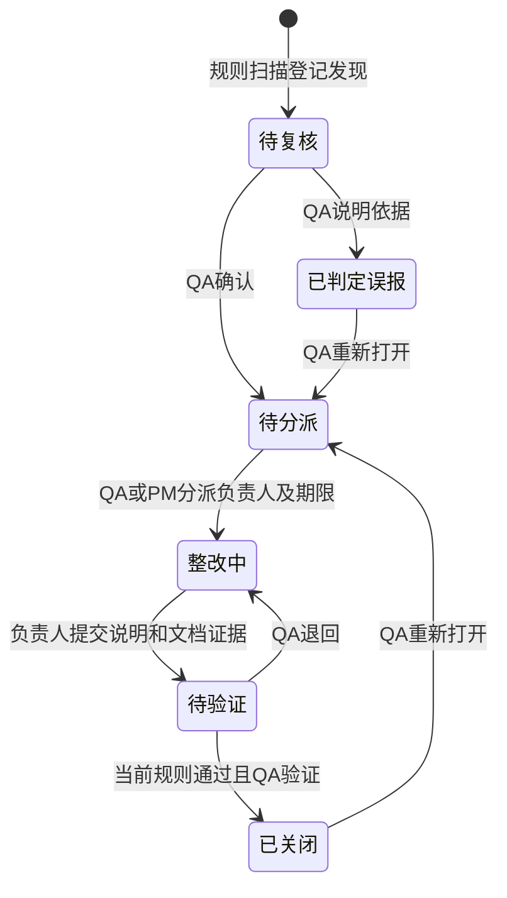

# 审计展示与整改闭环

## 业务边界

操作日志回答“发生了什么”，审查摘要回答“本次检查发现什么”，整改台账回答“由谁处理、证据是什么、是否通过验证”。三者分别保留，采纳 AI 摘要不等于关闭问题，也不构成项目验收或发布批准。

- `/audit`：ADMIN/QA 查询操作记录、执行合规检查、复核摘要和发现。
- `/audit/records/[auditId]`：ADMIN/QA 查看授权范围内的审计证据。
- `/audit/issues`：整改工作台；ADMIN 查看全局，QA/PM 查看所属项目，MEMBER 只查看所属项目中本人负责的问题。
- `/audit/issues/[issueId]`：发现、处理、提交证据与 QA 验证的完整时间线。
- 任务详情及任务抽屉使用同一审计展示组件；原始审计页访问权限不扩大。

## 可读展示

`src/modules/audit/presentation.ts` 通过确定性规则转换事件、字段和状态，不调用 LLM 改写事实。字段差异区分“未记录”和“未设置”，对象键顺序变化不算业务变更。原始 JSON、完整标识、IP 和 User-Agent 折叠保留。长文本预览截断，原始证据保持完整。

数据库存 UTC；审计记录显示 UTC+8，筛选输入使用浏览器本地时区并转换为 ISO 时间。`actorRole` 优先显示数据库插入时捕获的历史角色；历史记录没有角色时明确标注，不使用当前角色补造历史。

项目、任务、需求及项目内可见人员名称批量查询，标为“当前名称”。历史原始 ID 不变。资产可以具有比项目更严格的可见性，通用日志不额外解析受限资产名称。查询使用时间与 ID 排序和游标分页，筛选条件保留到 URL。

## 人工流程与权限

- QA 执行确认、误报、关闭、退回与重新打开。
- QA/PM 分派给项目内有效的 PM/MEMBER，截止日期必须在未来。
- 仅当前负责人可以提交整改；至少关联一份当前项目、本人及 QA 均可读取的 AVAILABLE 文档。
- 提交时保存文档 ID、文件名和 SHA-256。关闭时重新核对文件、权限和校验值。
- 关闭时在同一项目锁及事务快照内重新运行确定性规则。仍存在同类问题或业务扫描覆盖不完整时不能关闭；无关问题不阻塞此问题关闭。
- 验证事件保留规则版本、业务快照及其 SHA-256、覆盖信息、原提交 ID、验证时间、验证说明和验证人。
- 每次修改要求 `expectedRowVersion`，拒绝过期提交；事务内重新验证有效账号、项目权限和处理权限。

ADMIN 不代替 QA 作出正式复核。项目归档、取消后仍允许更新审计整改台账和导出报告，但台账不能修改被冻结的任务、需求、测试或附件。需要修改业务数据时仍走原业务流程及冻结校验。

## 模型、重复发现与历史兼容

- `AuditIssue`：持续问题，存项目、规则编码、稳定指纹、状态、风险等级、负责人、期限和行版本。
- `AuditIssueOccurrence`：不可变的单次发现，关联扫描摘要、findingKey 和当次来源证据。
- `AuditIssueEvent`：不可变的处理记录，保存操作人、前后状态、说明、证据及规则验证快照。

稳定指纹为“规则编码 + 主要业务记录 ID”，不包含需求版本，因此同一业务对象的同类问题跨版本持续跟踪。每次扫描追加 occurrence，不覆盖人工决定。已关闭/误报后再次发现时提示 QA 复查，必须人工重新打开。

旧摘要和旧复核记录不改写；重新扫描后登记持续问题。旧摘要首次执行问题复核时可登记该发现并同步当前待复核问题；不会自动关闭或重新打开已有问题。历史摘要通过引用关联持续台账。

## API

| API | 权限与行为 |
|---|---|
| `GET /api/audit` | ADMIN/QA；项目、操作人姓名/ID、操作、分类、对象和时间筛选；`nextCursor` 分页 |
| `GET /api/audit/issues` | ADMIN/QA/PM/MEMBER；授权范围列表、状态计数及逾期数量；`projectId/status/cursor` |
| `GET /api/audit/issues/[id]` | 同上；成员限本人问题，返回可选项目成员和本人/QA 可用文档 |
| `PATCH /api/audit/issues/[id]` | QA/PM/MEMBER；`action/expectedRowVersion/note`，按动作校验分派与证据 |
| `POST /api/audit/issues/report` | ADMIN/QA；`{projectId}`，下载可读 HTML 报告 |

原有扫描、摘要复核和问题复核 API 保持兼容，新增问题关联。新 API 使用 Zod 校验输入，无日志修改或删除 API。

HTML 报告包含项目全部问题、处理时间线和折叠原始发现/整改证据，并记录导出人、时间、项目及问题 ID 范围、格式和数据 SHA-256。所有内容转义，下载设置 CSP 和 no-store。超过 1000 项问题时明确拒绝生成不完整报告。审计写入失败时不返回导出文件。

## 迁移与部署

新增迁移 `20261101000000_audit_remediation`，仅增加三张表、外键、索引和证据不可变触发器。utf8mb4 / InnoDB / UUID char(36) / DATETIME(3)。不修改历史日志，不新增依赖、环境变量或向量 collection。

部署顺序：备份并应用 `pnpm db:deploy` → `pnpm db:generate` → 更新应用。数据库应用迁移后，再访问新工作台或执行扫描。代码回退可以保留三张新表；已有证据时应向前修复。

`rollback.sql` 仅在三张表全空时允许结构回滚，有证据时拒绝执行。集成测试在独立 `medpm_test_ia_*` 数据库内验证空库回滚、迁移重复执行、闭环、不可变触发器和事务回滚，绝不清除真实审计。

## 失败降级与限制

- LLM 不可用：规则发现和人工整改照常使用，摘要标记降级。
- 规则扫描不完整：保留发现及覆盖提示，关闭验证失败；不会报全部通过。
- 证据变化或权限撤回：提示重新提交，保留历史证据。
- 并发处理：返回 409，刷新后继续，不覆盖他人决定。
- 审计失败：业务状态、处理事件与日志一起回滚。
- 列表计数和列表是短时间内分别读取的，持续并发更新时可能出现瞬时差异；关闭决定使用事务重新校验。
- 详情显示最近 20 次发现，报告包含全部发现；处理时间线保留全部事件。
- 本次未实现外部通知、电子签名认证或完整 GxP/21 CFR Part 11 合规认证。

## 本次交付与验证（2026-10-24）

迁移前，当前演示库仅有本次迁移尚未应用；现已执行 `pnpm db:deploy`，迁移状态为 up to date，历史审计未改写。Prisma Client 已生成。没有新增依赖或修改环境配置。

| 检查 | 结果 |
|---|---|
| `pnpm lint` / `pnpm typecheck` | 全部通过 |
| `pnpm test` | 96 个文件，641 项测试通过 |
| 新增 MySQL 整改集成测试 | 8 项通过，包括迁移空库回滚及重复执行、并发决定、历史摘要兼容、证据和审计失败处理 |
| 原有 MySQL 合规集成测试 | 6 项通过 |
| Playwright | 新整改闭环和原合规流程 2 项通过；包含 52 条记录的分页查询、QA/PM/MEMBER 实际 UI 操作及报告下载 |
| 页面视觉检查 | 已检查闭环截图，证据默认折叠、时间线完整，长来源列表分层展示 |

验证截图：`output/audit-remediation/records.png`、`output/audit-remediation/closed-issue.png`。可读导出样例：`output/audit-remediation/report.html`。全部测试数据为合成数据，测试在隔离库执行。

主要变更文件清单：

- 审计展示/查询：`src/modules/audit/presentation.ts`、`repositories.ts`、`query.ts`、`service.ts`；`src/components/audit/audit-entry.tsx`、`source-audit-links.tsx`。
- 整改领域：`src/modules/audit/issue-schema.ts`、`issue-transition.ts`、`issue-repositories.ts`、`issue-service.ts`、`report.ts`。
- 审计页面：`src/app/audit/page.tsx`、`viewer.tsx`、`compliance-panel.tsx`、`records/[auditId]/page.tsx`、`issues/page.tsx`、`issues/[issueId]/page.tsx`。
- 整改组件：`src/components/audit/issues-workspace.tsx`、`issue-detail.tsx`。
- API：`src/app/api/audit/route.ts`、`issues/route.ts`、`issues/[issueId]/route.ts`、`issues/report/route.ts`。
- 任务入口：`src/app/tasks/[taskId]/page.tsx`、`src/components/tasks/task-detail-drawer.tsx`。
- 扫描与复核关联：`src/modules/ai/compliance-audit/service.ts`、`repositories.ts`、`review-service.ts`。
- 权限入口与冻结分类：`src/components/layout/navigation.ts`、`src/modules/projects/freeze-manifest.ts` 及对应测试。
- 模型/迁移：`prisma/schema.prisma`、`prisma/migrations/20261101000000_audit_remediation/migration.sql`、`rollback.sql`。
- 新增测试：`src/modules/audit/presentation.test.ts`、`issue-schema.test.ts`、`tests/integration/audit-remediation.test.ts`、`e2e/audit-remediation.spec.ts`；更新 `e2e/compliance.spec.ts` 以验证中文展示。

建议提交信息：`feat(audit): add readable evidence and remediation workflow`。变更保留在现有工作分支，未提交、未合并。
