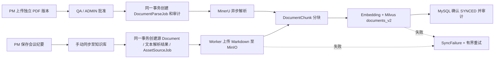

# 核心资产与交付物：阶段一

任务签署完成必须能够指向经过审批的具体文件版本。交付物审批、文件存储与 AI 索引分别记录状态，索引故障不会撤销审批或阻塞业务交付。

## 数据与权限

- `Deliverable`：项目、可选任务、独立 Document、版本系列、递增文件版本、审批状态、创建/提交/审批人、意见和时间，以及 `rowVersion` 乐观锁。`documentId` 唯一，文件不能重复绑定或覆盖。批准版本冻结，修改须创建新版本。PM 维护和提交，项目内 QA/ADMIN 审批；创建人和提交人均不得自审，即使之后升为 ADMIN。
- `Task.requiresDeliverable`：默认 false；PM/ADMIN 可配置，携带 `expectedUpdatedAt`，已完成任务须先重新打开。任务完成事务重新检查权限、交付要求和同项目同任务的 APPROVED + AVAILABLE 文件，再验证原电子签名并写任务与审计。审计固定交付物 ID、文件版本、审批人、Document ID 和 SHA-256。存在已批准旧版本即可完成，新草稿不撤销旧批准。
- `MeetingRecord`：UTC 会议时间、正文、结构化行动项、可见角色、创建者、幂等请求标识。PM 创建，保存后只读。本期不自动创建任务。PM 专属纪要对其他普通角色隐藏，ADMIN 可管理。纪要审计保留正文与行动项的摘要哈希、数量和角色，不把私有正文复制到面向 QA 的项目审计中。
- `Document`：复用原 MinIO、完整性校验、上传恢复和下载审计，增加 `documentType` 和 `visibleRoles`。第一阶段交付文件支持 PDF，会议原文保存为 Markdown。新文件版本使用新 key 和新 SHA-256。
- `AssetSourceJob`：会议源文件持久队列，带租约、重试次数、退避时间。失败进入 SyncFailure；不依赖 HTTP 请求生命周期。

## API

| 路径 | 操作 |
|---|---|
| `/api/projects/[projectId]/documents` | 复用 PDF 上传和列表，按可见角色过滤 |
| `/api/projects/[projectId]/deliverables` | GET 分页/按任务筛选；POST 创建草稿 |
| `/api/deliverables/[id]` | GET 详情；PATCH 仅允许草稿名称和 rowVersion |
| `/api/deliverables/[id]/versions` | POST 独立文件的新版本 |
| `/api/deliverables/[id]/submit` | POST PM 提交，确认批准后外部解析与嵌入处理 |
| `/api/deliverables/[id]/review` | POST QA/ADMIN 的 APPROVED/REJECTED 决定，拒绝必须有原因 |
| `/api/deliverables/[id]/index` | POST 已批准文件的同步重试 |
| `/api/projects/[projectId]/meetings` | GET 可见记录分页；POST PM 创建归档纪要 |
| `/api/meetings/[id]` | GET 详情，检查项目和 visibleRoles |
| `/api/meetings/[id]/index` | POST PM/ADMIN 手动同步或重试，需外部处理确认 |
| `/api/tasks/[id]` | 返回批准证据；PATCH 配置交付要求与 DONE 拦截 |

所有业务写入和对应审计在同一 MySQL 事务中。审批/配置过期返回 409；跨项目或自审返回 403；缺少交付物返回 400。body 严格 Zod 校验，创建/编辑不能传 status 来绕过审批。MinIO/模型网络 IO 放在事务外。

## 异步索引

运行 `pnpm documents:worker`。会议正文已是文本，无需调用 PDF 解析服务；持久化原文后复用现有分块、嵌入、租约和向量写入流水线。向量任务最多自动尝试 5 次，可手动重试。人工重试不覆盖活跃 Worker 的租约。资产索引状态由源文件、解析、分块和当前版本向量状态合成，展示未同步 / 同步中 / 已入库 / 同步失败；已批准也可能仍在同步，两个状态不可混同。

## Milvus v2 迁移

原 `documents` 关闭动态字段，保留原集合，新增 `documents_v2`。字段为 `id`、`docId`、`documentId`、`projectId`、`documentType`（DOCUMENT/DELIVERABLE/MEETING）、`visibleRoles`（JSON 角色数组）、`deliverableId`（非交付物为空串）、1536 维 embedding 和 createdAt。HNSW/COSINE 保持原配置。

1. `pnpm vector:init` 创建或复用 v2，不删除旧集合。
2. 切换应用适配器到 v2；未回填的来源降级为 MySQL 关键词检索。
3. 需要回填历史来源时运行 `node scripts/reindex-documents-v2.mjs --confirm`，重新排队并逐项目审计；正常 Worker 执行嵌入与 upsert，活跃租约不动。该操作可能调用配置的嵌入服务，本次未批量执行。
4. 核对 chunk ID、当前版本、projectId 和角色检索，再决定旧集合的长期保留策略。本次未删除旧集合。

向量过滤使用经过校验的项目 UUID 和 `JSON_CONTAINS(visibleRoles, "ROLE")`；管理员按既有规则可管理所有角色资产。未来全局检索必须从会话计算有权访问的项目集合，不能接受前端传来的角色或项目白名单。当前项目 RAG 同样进行 MySQL 角色、项目和版本复核，关键词降级遵守相同条件，并在返回前重新核对操作者角色。未批准交付物不进入检索结果。源文档 API、会议详情及引用页也检查可见角色。本次不增加全局搜索 UI。

实际 Milvus 验证：`node src/modules/vector/verify-assets.mjs` 仅创建并清理两个合成向量；PM 命中 2 条、QA 命中 1 条、其他项目 0 条。结果见 `test-results/assets-milvus-verification.json`。

## 迁移与运行

`20261018000000_core_delivery_assets/migration.sql` 仅增加表和字段，检查列存在性并使用 CREATE TABLE IF NOT EXISTS，可重复执行；历史任务默认 false，不更改原任务状态、既有约束或审计。已在独立库部署、重复执行并验证 true 标记不会被重置，然后部署到当前演示库。Prisma Client 生成后，4000 开发服务和文档/风险 Worker 已恢复。

回滚优先回滚应用并保留增量数据结构。`down.sql` 只允许资产表为空且没有启用交付要求的任务时结构回滚；有业务资产时主动失败，须先制定保留方案。MySQL DDL 不能承诺整个迁移事务回滚。不要对演示库执行 reset 或测试 seed。

## 验证与截图

- lint、typecheck、460 项单测通过。
- 全量真实 MySQL 集成 135 项通过、2 项按配置跳过；末次安全补测资产 10 项通过（原 8 项加私有审计与 Worker 租约边界），共覆盖 137 项不同集成用例。
- 全量页面 E2E 96 项通过，流式协议 E2E 8 项通过，共 104 项；另 4 项文档/风险 worker 场景按配置跳过。新增资产 3 项覆盖真实上传与审批、版本冻结、签署证据、跨项目 403、自审 403、status 注入和会议可见性。
- 单测与集成注入存储/嵌入适配器验证会议完整队列、分块、写入元数据、SyncFailure、重试和角色过滤。页面验收使用真实应用/MySQL 与 S3 协议夹具；实际 Milvus 另行验证，不宣称浏览器测试已走外部 MinerU/嵌入供应商。
- 日志：`test-results/assets-unit.log`、`assets-acceptance.log`、`assets-final-integration.log`、`assets-final-e2e.log`。
- 截图目录：`test-results/delivery-assets-evidence/`，包括卡片标识、交付 Tab 与引导、已批准哈希证据、会议行动项和版本对比。

核心修改文件：`prisma/schema.prisma` 与上述迁移；`src/modules/assets/`；新增 deliverables/meetings API 和项目页面；任务创建/详情 API、`modules/audit/service.ts`；`components/assets/`、任务卡片/抽屉/看板；`modules/documents/` 的 Worker/权限过滤与 `modules/vector/` 的 v2 schema/适配器；对应单测、真实数据库测试及 `e2e/delivery-assets.spec.ts`。未增加依赖。
