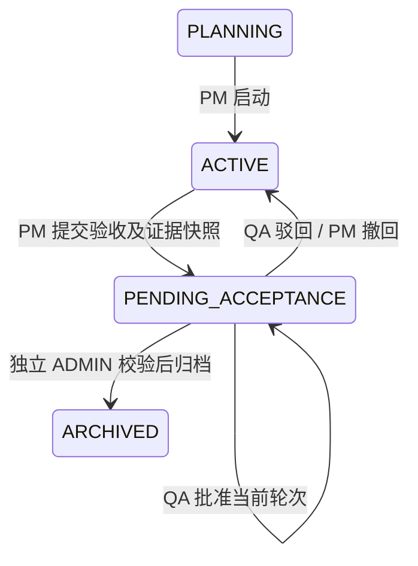

# 项目验收、归档与冻结

本次改造把任务执行接入结项闭环：PM 提交证据，QA 独立审查，ADMIN 最终归档。归档是不可逆的业务终态，当前不提供解冻接口。

## 状态与验收轮次

历史 `ON_HOLD`、`COMPLETED` 值保留，不自动视为已归档；PM 显式启动后才进入新流程。驳回和撤回保留原验收轮次，新提交产生新轮次，旧 QA 批准不能复用。

`Project.rowVersion`、当前验收 ID 和请求 UUID 防止旧页面提交、跨轮次批准与重复提交。所有流转在同一 MySQL 事务内重新查询角色、项目访问权限，并锁定 Project 行。QA 不得审查本人提交的验收，最终 ADMIN 必须与提交人、QA 为不同账号。

## 快照边界与校验

`ProjectAcceptance.snapshot` 仅保存核心证据：

- 任务 ID、名称、状态、是否要求交付物、实际工时。
- 交付物 ID、任务 ID、版本、审批状态、关联文档 ID、SHA256 和存储状态。
- `TASK_SIGNED_AND_COMPLETED` 签名审计记录 ID。

不复制文件正文、存储凭据、签名密码或会议全文。对象键按固定规则排序，数据库查询按 ID 排序，Decimal 转为字符串，再计算 UTF-8 JSON 的 SHA256。QA 批准与 ADMIN 归档均同时检查保存快照的哈希和当前证据的哈希；不一致返回 409，要求驳回后重新提交。快照自身的核心字段由数据库触发器禁止更新和删除。

任务必须非空且全部 DONE；要求交付物的任务必须关联 APPROVED、文件可用且带哈希的交付版本。证据数量设有显式上限，超限拒绝提交，不会截断后静默归档。

## 三层写保护

| 层级 | 保护范围 | 行为 |
| --- | --- | --- |
| HTTP | 项目路径及任务、文档、交付物、会议等资源路径 | 鉴权后预检项目状态；ARCHIVED 返回 403 / `PROJECT_ARCHIVED` |
| 事务 | 业务服务及异步 Worker | 写前锁 Project 并重查状态，消除 HTTP 检查到提交之间的竞态 |
| MySQL | 18 张业务表及项目、验收记录等特殊表 | BEFORE INSERT/UPDATE/DELETE，阻止绕过 API 的 SQL 写入 |

业务表清单位于 `src/modules/projects/freeze-manifest.ts`，单测要求每个带 projectId 的 Prisma 模型必须明确归类，防止新增表遗漏保护。排期字段位于 Task，不另建 Schedule 表。

触发器通过 `Project.id` 主键定位并 `FOR UPDATE`，不扫描项目全表。间接关联表经父记录定位项目，变更关联时检查旧、新双方。业务主键禁止变更；容易绕过子表触发器的级联删除/更新改为 RESTRICT，User 主键也禁止修改。

数据库报错使用 SQLSTATE 45000、MySQL errno 1644，消息标识为 `ER_ARCHIVED_PROJECT`；统一错误映射为 403 和“项目已归档，禁止修改”，不暴露 SQL 堆栈。待验收期间 API 和事务阻止业务修改（409），数据库的归档冻结在 ARCHIVED 时生效。

归档事务先检查上传及异步租约：有正在提交的后台工作则返回 409。没有有效租约时取消排队任务、停用风险扫描，然后更新验收和项目状态，写通知与审计；任一操作失败则整体回滚。Worker 候选查询跳过归档项目，写入仍受事务和数据库双重检查。

冻结不阻止查看、下载及其追加审计、只读报告导出、个人通知已读。`AuditLog` 原有不可更新/删除约束保留。全局人员容量属于账号级数据；从项目上下文修改时仍检查项目写权限。

数据库触发器防护的边界是运行时 DML 账号。拥有 DDL/超级权限的数据库管理员可以删除触发器；部署时应分离迁移账号与应用账号，本实现不声称能防御数据库超级管理员。

## API

所有结项 POST 请求使用严格 Zod 输入：`expectedRowVersion`、`requestKey`，当前轮次操作还需 `acceptanceId`；驳回/撤回必须填写 `comment`。

| 路径 | 方法 | 权限 / 结果 |
| --- | --- | --- |
| `/api/projects/:id/lifecycle` | GET | 有项目访问权的用户；返回状态、轮次历史、Capabilities |
| `/api/projects/:id/activate` | POST | PM 启动规划或历史兼容状态 |
| `/api/projects/:id/submit-acceptance` | POST | PM 提交验收与快照 |
| `/api/projects/:id/qa-approve` | POST | QA 批准当前快照 |
| `/api/projects/:id/reject-acceptance` | POST | QA 驳回 |
| `/api/projects/:id/withdraw-acceptance` | POST | PM 撤回 |
| `/api/projects/:id/archive` | POST | ADMIN 独立最终归档 |
| `/api/projects/:id/report?format=json\|html` | GET | 归档后 PM / QA / ADMIN；下载并审计，`preview=1` 内联预览 |
| `/api/project-notifications` | GET | 当前用户的归档站内信 |
| `/api/project-notifications/:id/read` | POST | 仅当前收件人标记已读 |

报告依据冻结快照生成，包含任务、工时、交付版本及哈希、签名审计 ID 和审批元数据；HTML 转义所有业务文本并设置禁止脚本的 CSP。报告导出记录 `DATA_EXPORTED` 审计。

## 前端恢复策略

项目 Layout 提供服务端计算的 `ProjectCapabilitiesProvider`。看板、甘特图、成员、文档、交付物、会议及 AI 操作使用 Context 判定编辑权限；归档顶部显示标签、时间和报告入口。待验收也切为业务只读，整改须先撤回或驳回。

项目请求收到 403 后立即关闭写能力、递增工作区 epoch，卸载旧编辑组件以丢弃未保存输入和甘特图乐观变更，再刷新能力与页面；提示“该项目已被归档/权限已变更，页面已刷新”。SSE 权限错误经统一事件进入相同恢复逻辑。窗口聚焦和可见页面的 15 秒检查补充状态同步，服务端仍是权限依据。

## 迁移与维护

迁移：`prisma/migrations/20261019000000_project_acceptance_freeze/migration.sql`。

- 保留历史枚举与全部业务/审计记录，新增字段带兼容默认值。
- 新表及新增列/索引有存在性检查；触发器按名称重建。生产迁移仍应通过 Prisma migration history 管理，不手工反复执行。
- MySQL DDL 隐式提交，部署前备份，先在隔离库验证，再在维护窗口应用。
- 同目录 `down.sql` 仅供受控维护时撤下数据库保护，保留证据表和历史数据；它不自动解冻项目，也不是无损恢复到旧代码的完整逆迁移。执行期间必须停止应用写入，恢复保护后再开放服务。

## 验证

单测覆盖确定性哈希、快照差异、错误映射、Capabilities、HTML 转义及模型保护清单。真实 MySQL 集成测试覆盖 SQL 直写、旧新项目关联绕过、级联边界、快照篡改、并发 SQL 与归档、审计/通知失败的整体回滚、Worker 冻结及历史状态兼容。

Playwright 验证完整 PM → QA → ADMIN 流转、交付物审批与电子签名、快照不一致后的 409 和驳回、导出 JSON/HTML，以及真实请求期间被降权/归档后的甘特图回滚与只读恢复。本次验收使用独立合成数据库，不向演示库写测试任务。

运行 `pnpm lint`、`pnpm typecheck`、`pnpm test`，然后执行 `node scripts/test-project-ia.mjs`，顺序完成真实 MySQL 集成、常规 E2E 和流式模型协议夹具 E2E。验收脚本为每轮创建独立数据库及构建目录；注册 HTTP 测试另用独立目录，退出时等待服务停止并恢复生成的类型配置。监听本地端口须获得环境许可。

长时间开发模式回归的测试服务默认使用 6 GiB V8 堆上限，已有 `NODE_OPTIONS` 时保留调用者配置。异常退出保留最近服务日志至 `test-results/ia-server-last.log`，便于区分服务退出与业务断言失败；这项配置仅用于验收进程。

MinIO 浏览器测试使用 S3 协议夹具，流式模型使用可控服务夹具；这不代表已经验证真实 MinerU 或模型供应商的在线服务。Live 集成测试及既有未启用的 Worker E2E 必须与通过项分开报告。

主要实现入口：

- 模型与数据库：`prisma/schema.prisma`、本次 migration 及 `down.sql`。
- 状态机、快照与导出：`src/modules/projects/acceptance.ts`、`closure-report.ts`。
- HTTP/事务冻结：`write-scope.ts`、`freeze.ts`、`src/modules/auth/transaction-locks.ts`。
- 前端能力与结项页：`src/components/projects/capabilities-context.tsx`、`acceptance-panel.tsx`。
- 验证：`tests/integration/project-closure.test.ts`、`e2e/project-closure.spec.ts`。

未引入依赖、环境变量或新的 Milvus collection。建议提交信息：`feat(projects): add acceptance snapshots and archive freeze`。

本次最终验证：lint、typecheck 通过；75 个单测文件共 465 项通过；真实数据库集成 151 项通过（含结项专项 14 项），2 项 live 测试跳过；常规 E2E 100 项、独立流式 E2E 8 项通过。常规组暂跳过的 8 项流式用例已在独立组全部执行，最终仍未启用的为 4 项既有 Worker E2E。集成日志：`test-results/closure-verified-acceptance.log`；最终浏览器日志：`test-results/closure-verified-e2e.log`。

截图及 JSON/HTML 合成结项报告位于 `test-results/closure-evidence/`，覆盖完整流转、未完成任务拦截、快照不一致拦截，以及拖拽途中撤权或归档后的只读恢复。
