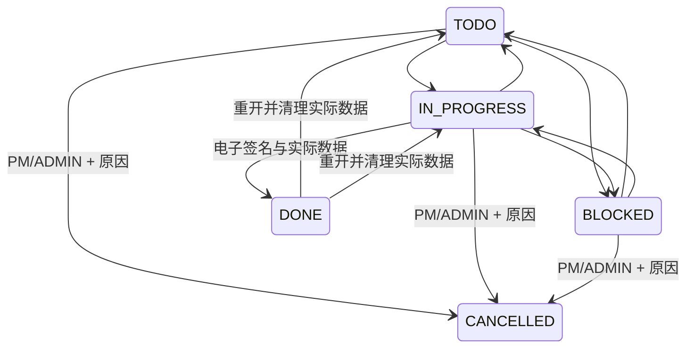

# 任务取消与重开

## 状态与事务

`CANCELLED` 为终态。PM / ADMIN 可将 TODO、IN_PROGRESS、BLOCKED 任务取消，必须填写去除首尾空白后 10–1000 字的原因；DONE 必须先明确重开，再取消。MEMBER 保留原有本人任务执行与签署权限，不能取消或重开。

PATCH `/api/tasks/[taskId]` 取消请求为 `{status:"CANCELLED", cancelReason, expectedRowVersion}`。沿用项目/用户事务锁，在事务内重新检查项目访问权限、项目冻结、任务状态及观察到的版本，更新任务并追加 `TASK_CANCELLED`。关联后续任务追加 `TASK_DEPENDENCY_INVALIDATED`。审计写入失败时业务更新一并回滚。

取消任务禁止分配、改计划、签署、关联或修改交付物；服务返回 409 / `TASK_CANCELLED`。项目冻结仍优先走共享防线，不另建冻结系统。取消前置任务后，卡片与抽屉明确警告，后续任务不能直接启动或完成，PM 应先重新评估和调整依赖。

## 版本与签名证据

新增 `rowVersion`、`signatureEvidenceVersion`、`cancelReason`、`cancelledAt`、`cancelledById`。数据库触发器对每次 Task UPDATE 增加版本，避免不同入口遗漏。取消、重开以及严格模式任务签署必须携带观察到的版本；普通更新及历史模式首次签署保留旧客户端兼容，当前界面均发送版本。

DONE 重开到 TODO / IN_PROGRESS 时，原子清空 **actualHours、completedAt、completionRoundId**，切换严格证据模式 2，写入 `TASK_REOPENED`。下次成功签署才生成全新轮次 UUID。严格模式空轮次不能退回历史匹配规则，封堵同日重开复用旧签名的漏洞；历史模式 1 保留原有证据兼容。历史审计从不删除或覆盖。

新验收快照使用 v4，纳入取消证据与签名版本，单独保存取消审计 ID；既有 v1/v2/v3 快照继续按原结构校验。

## 界面与统计

取消入口置于折叠菜单，二次确认弹窗自动聚焦原因输入。取消任务在默认折叠的独立区域显示，卡片置灰/删除线，详情显示原因及只读状态，表单与保存按钮禁用；甘特条置灰且不可拖拽。取消成功后即使看板和详情刷新均失败，抽屉仍立即进入只读，并提示已取消但刷新失败。

Dashboard、PMO 项目健康度、资源负荷、逾期统计、风险扫描和验收规则均将 CANCELLED 排除出执行中/未完成口径。完成率分母排除取消任务；全部取消不视为完成，也不能通过验收。历史审计、历史交付物创建趋势和取消证据继续保留。

## 迁移

`prisma/migrations/20261025000000_task_cancel_reopen/migration.sql` 扩展枚举和元数据，复用现有三个 Task 触发器，项目冻结触发器总数仍为 60。迁移不 UPDATE 历史任务、不改审计。部署期间应停止业务写入，因为 MySQL DDL 不具备跨语句事务原子性。

独立 MySQL 验证已覆盖回滚、重新部署、重复执行及旧字段保留。`rollback.sql` 在已有取消/重开证据或严格模式任务时主动拒绝破坏性回滚，应采用前向修复。

当前本地演示库已部署此迁移。迁移前后均为 **3 个项目、43 个任务、175 条审计**，历史任务字段和全部审计的 SHA256 均一致；原 43 个任务维持历史证据模式。未重新 seed、未清理业务记录，4000 应用服务保持关闭。

## 验证记录

- `pnpm lint`、`pnpm typecheck` 通过；单测 83 个文件、536 条通过。
- MySQL 全量集成测试首次运行的风险调度旧夹具不符合已有项目冻结规则；修正夹具后，风险、Dashboard、任务生命周期及计划/实际 44 条专项全部通过。全量与复测合计覆盖 223 条不同集成用例，另 2 条实时供应商用例跳过。
- 全量 E2E 主组 116 条通过，独立流式组 18 条通过；追加刷新失败用例后，任务生命周期 5 条专项全部通过。合计 135 条不同 E2E 通过，4 条未启用 Worker 的既有用例跳过。
- 关键断言覆盖越权、过期版本、取消与分配并发、审计失败真实回滚、直接 SQL 拒绝修改、同日重签轮次隔离、空轮次漏洞、依赖警告、只读控件及取消后刷新失败。

测试使用独立数据库，不污染演示数据。新生命周期 E2E 默认不采集截图；确有需要时可通过 `E2E_CAPTURE_EVIDENCE=1` 开启。

## 主要修改文件

| 范围 | 文件 |
| --- | --- |
| 模型与迁移 | `prisma/schema.prisma`、`prisma/migrations/20261025000000_task_cancel_reopen/` |
| 状态、输入、签名 | `src/modules/tasks/{status,lifecycle,lifecycle-schema,signature,signature-evidence}.ts` |
| API 与事务 | `src/app/api/tasks/[taskId]/route.ts`、`src/modules/audit/service.ts`、`src/modules/projects/freeze.ts` |
| 查询与业务口径 | `src/modules/dashboard/repositories.ts`、`src/modules/planning/`、`src/modules/ai/{risk,compliance-audit}/`、`src/modules/projects/{acceptance.ts,acceptance-check/repository.ts}` |
| 界面 | `src/components/tasks/`、`src/app/projects/[projectId]/board/task-board.tsx`、交付物面板与甘特组件、`src/components/toast-provider.tsx` |
| 验证 | `src/modules/tasks/lifecycle.test.ts`、`tests/integration/task-lifecycle.test.ts`、`e2e/task-lifecycle.spec.ts` 及相关回归夹具 |
