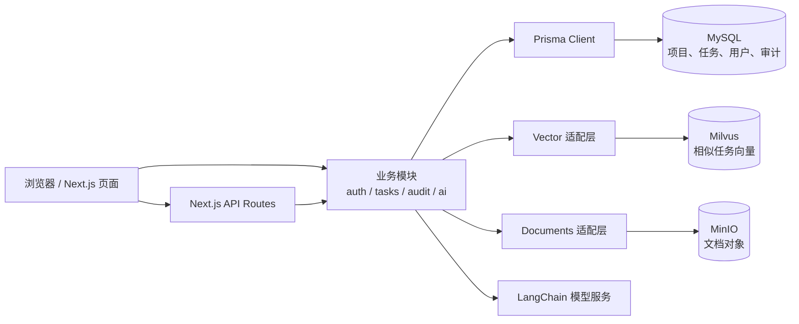

# MedPM-AI 项目详细说明

> 面向第一次参与本项目开发的阅读者。本文描述的是**当前仓库代码**，不是最终产品蓝图。代码、README 和历史任务模板有不一致时，以当前实现为准，并在“已知差异与问题”中标出。

## 1. 这个项目要解决什么问题

MedPM-AI 是医疗软件交付团队使用的项目协作和合规追溯平台。它围绕项目、需求、任务、测试和审计记录组织数据，并尝试把 AI 放进实际工作流：

1. **WBS 分解 Agent**：根据 PM 输入的合成需求和历史已完成任务，生成可逐条审阅的任务建议。
2. **合规审计 Agent**：检查任务、需求、测试用例和审计记录之间的追溯关系，并生成审计摘要。
3. **风险预警 Agent**：根据任务期限、人员负荷、前置任务和历史延期等规则提出风险提示。

AI 的定位是“提供建议”。建议默认待人工确认，不能绕过 PM 直接成为正式任务；风险 Agent 也不自动改变任务状态。项目只允许使用合成数据，不得录入真实患者信息（PHI）。

## 2. 用一张图看懂系统



**怎么理解这张图：**浏览器显示页面并发送请求；API Route 检查登录状态、权限和输入；业务模块实现规则；Prisma 负责读写 MySQL。只有 `src/modules/vector` 应直接依赖 Milvus SDK。对象存储由 `src/modules/documents` 封装。AI 模块可以调用模型，但结果先保存在建议表中，等待人工决定。

## 3. 技术栈和常用命令

| 部分 | 当前使用 | 用途 |
|---|---|---|
| Web 页面和 API | Next.js 15 App Router、React 19、TypeScript | 页面 SSR、客户端交互、API Route |
| 样式 | Tailwind CSS；项目有 shadcn/ui 配置和少量 UI 组件 | 页面样式和组件基础 |
| 关系数据库 | MySQL 8、Prisma 6 | 用户、项目、任务、审计等关系数据 |
| 向量数据库 | Milvus 2.6 | WBS 历史任务的相似检索；文档 collection 也有初始化定义 |
| 对象存储 | MinIO | 文档对象存储的客户端封装 |
| AI 接入 | LangChain.js | OpenAI、Anthropic 或 Gemini 聊天模型，以及 OpenAI embedding |
| 测试 | Vitest、Playwright | 单元测试和浏览器端流程测试 |
| 本地服务 | Docker Compose | MySQL、Milvus、etcd、MinIO，Redis 为可选服务 |

仓库中的 `package.json` 命令：

```powershell
pnpm dev          # Next.js 开发服务器，端口 4000
pnpm build        # 生产构建
pnpm start        # 运行生产构建
pnpm lint         # ESLint 检查 src
pnpm typecheck    # TypeScript 类型检查
pnpm test         # Vitest 单元测试
pnpm test:e2e     # Playwright 浏览器测试
pnpm db:generate  # 根据 Prisma schema 生成客户端
pnpm db:deploy    # 应用已有 migration
pnpm db:migrate   # 开发环境创建 migration（通常带 --name 名称）
pnpm db:seed      # 写入可重复执行的合成演示数据
pnpm vector:init  # 初始化 documents 向量 collection
```

本地开发服务由 `pnpm dev` 使用 `http://localhost:4000`。Docker Compose 中生产 app 容器暴露的是 `http://localhost:3000`。两种端口不同是正常的。`playwright.config.ts` 默认启动 4000 端口的开发服务器，也可以用 `E2E_BASE_URL` 指向已有服务器。

## 4. 目录导航：改功能时先去哪儿找

```text
src/
  app/                         页面和 API 路由（Next.js 入口）
    api/                       HTTP API；通常负责鉴权、Zod 校验、调用服务
    projects/                  项目列表和项目任务看板
    tasks/[taskId]/             任务详情页
    audit/                     审计查看页
  modules/
    auth/                      当前用户、签名 Cookie、RBAC
    audit/                     审计写入、审计过滤条件
    tasks/                     任务状态规则
    projects/                  项目模块说明（当前业务实现主要在 API/Prisma）
    ai/                        WBS、合规审计、风险提示和模型接入
    vector/                    Milvus 客户端、集合、历史任务检索
    documents/                 MinIO 客户端（文档处理仍不完整）
  lib/prisma.ts                全应用共享的 Prisma Client
prisma/
  schema.prisma                当前数据库结构的声明来源
  migrations/                  按时间顺序演进数据库的 SQL
  seed.mjs                     合成演示数据
e2e/tasks.spec.ts              浏览器端核心任务流程测试
docs/prompts/                  分阶段开发任务模板（仓库当前目录为 docx/prompts）
```

### 阅读代码时的常见分工

- `src/app/**/page.tsx`：页面入口；服务端页面可以直接查 Prisma，再把安全、必要的数据传给客户端组件。
- `src/app/**/route.ts`：API Route。一般先 `getCurrentUser()`，再用 `requireRole()`；输入通过 Zod；完成后用 `NextResponse.json()` 返回。
- `src/app/**/task-board.tsx` 等客户端组件：表单、按钮、fetch 调用和页面状态更新。
- `src/modules/**/service.ts`：跨页面可复用的业务流程和数据库事务。
- `src/lib/prisma.ts`：统一 Prisma Client。不要在每个 API 自己 `new PrismaClient()`。
- `prisma/schema.prisma`：数据库表和关系的主定义；migration 才是实际部署时的数据库变更脚本。

## 5. 当前有哪些页面和能力

| 路径 | 页面作用 | 当前实现情况 |
|---|---|---|
| `/` | 产品入口，链接到项目和审计 | 有静态首页和 Agent 简介 |
| `/projects` | 项目列表 | 服务端读取 MySQL 项目 |
| `/projects/[projectId]/board` | 项目任务看板 | 创建任务、查看任务、更新状态、PM 分配成员；有 WBS 和风险面板 |
| `/tasks/[taskId]` | 单个任务详情 | 显示状态、工时、关联需求/测试、前置任务和审计时间线 |
| `/audit` | 审计查看 | 筛选审计记录并触发合规摘要；仅 ADMIN/QA |

**目前没有登录、注册或用户管理页面。**虽然首页和 API 有认证/授权代码，但没有从页面输入用户名密码并登录的完整入口。

## 6. API 一览和权限

所有受保护的 API 都按服务端当前用户角色授权。客户端自己传入的角色不能代替服务端校验。

| API | 方法 | 当前角色要求 | 作用 |
|---|---|---|---|
| `/api/health` | GET | 无需登录 | 检查 MySQL、Milvus、MinIO；未配置的服务显示 `not_configured` |
| `/api/projects` | GET | 任意已认证角色 | 返回项目列表 |
| `/api/projects/[projectId]/tasks` | GET | 任意已认证角色 | 返回项目任务及负责人、需求、依赖 |
| `/api/projects/[projectId]/tasks` | POST | ADMIN、PM | 创建任务并写 `TASK_CREATED` 审计 |
| `/api/tasks/[taskId]` | GET | 任意已认证角色 | 查询任务详情数据和审计记录的 API 形式 |
| `/api/tasks/[taskId]` | PATCH | ADMIN、PM、MEMBER | 改状态；PM 可分配负责人；MEMBER 只能操作分配给自己的任务 |
| `/api/users` | GET | 当前代码只允许 PM | 为看板返回用户列表，供分配负责人使用 |
| `/api/audit` | GET | ADMIN、QA | 按项目、人员、操作和时间过滤审计记录 |
| `/api/audit/summary` | POST | ADMIN、QA | 运行项目追溯检查并生成/降级为规则摘要 |
| `/api/projects/[projectId]/ai/wbs` | GET、POST | PM | 列出待确认 WBS 建议；根据输入生成建议 |
| `/api/ai/wbs/[suggestionId]` | PATCH | PM | 接受或拒绝一条 WBS 建议 |
| `/api/projects/[projectId]/ai/risk` | GET、POST | PM | 查看待处理风险并触发规则扫描 |
| `/api/ai/risk/[suggestionId]` | PATCH | PM | 标记风险已处理或忽略 |

### 权限错误是什么意思

- `401 Authentication required`：没有有效会话 Cookie。
- `403 Forbidden`：已识别出用户，但该角色不能执行此操作。
- 请求体错误一般返回 `400`；找不到资源常见为 `404`；冲突或状态不可转换常见为 `409`。

## 7. 数据库：表、关系和重要规则

数据库声明在 `prisma/schema.prisma`，数据库是 MySQL。ID 使用 UUID 字符串，时间字段使用 UTC 的 `DATETIME(3)`，业务变化应通过 migration 演进。

### 13 个 Model

| Model | 用途 | 重要关系/字段 |
|---|---|---|
| `User` | 用户、角色、状态 | `role`、`status`、可空 `passwordHash`、`isSystem`、登录失败与锁定字段 |
| `Session` | 预留的数据库会话记录 | `tokenHash`、过期/撤销时间、IP 和 User Agent |
| `PasswordResetToken` | 预留的密码重置令牌 | 只存 token hash、失效/使用时间 |
| `Project` | 项目 | 可选负责人，拥有任务、需求、文档、建议、审计记录 |
| `Task` | 正式工作项 | 状态、负责人、需求、工时、期限、完成时间 |
| `TaskDependency` | 任务前置依赖 | 连接任务与其前置任务 |
| `Requirement` | 项目需求 | 版本、状态、正文；可关联多个任务和测试用例 |
| `TestCase` | 需求测试用例 | 状态从 `NOT_RUN` 等枚举中选择 |
| `AIRecommendation` | 早期版本遗留的建议表 | 保留兼容用途；当前 Agent 主要使用 `AiSuggestion` |
| `AiSuggestion` | WBS/风险等待审阅建议 | 输入和输出为 JSON，带类型、状态、审核人 |
| `AuditLog` | 不可变审计事件 | actor、action、entity、before/after、project、IP、UA、时间 |
| `Document` | 项目文档元数据 | MinIO object key、文件名、解析文本 |
| `SyncFailure` | 外部同步失败重试记录 | 失败目标、payload、错误、retryCount |

### 9 个 Enum

| Enum | 值 |
|---|---|
| `Role` | `ADMIN`, `PM`, `MEMBER`, `QA` |
| `UserStatus` | `ACTIVE`, `DISABLED`, `PENDING` |
| `ProjectStatus` | `PLANNING`, `ACTIVE`, `ON_HOLD`, `COMPLETED` |
| `TaskStatus` | `TODO`, `IN_PROGRESS`, `BLOCKED`, `DONE` |
| `RequirementStatus` | `DRAFT`, `IN_REVIEW`, `APPROVED`, `RETIRED` |
| `TestCaseStatus` | `NOT_RUN`, `PASSED`, `FAILED`, `BLOCKED` |
| `AIRecommendationStatus` | `PENDING_CONFIRMATION`, `ACCEPTED`, `REJECTED` |
| `AiSuggestionStatus` | `PENDING`, `ACCEPTED`, `REJECTED` |
| `AiSuggestionType` | `WBS`, `ESTIMATE`, `RISK`, `AUDIT_SUMMARY` |

### 关系的直观版本

```text
User ──拥有──> Project ──包含──> Task
                         ├────> Requirement ──包含──> TestCase
                         ├────> AiSuggestion
                         ├────> Document
                         └────> AuditLog
Task ──可关联──> Requirement
Task ──TaskDependency──> 前置 Task
AuditLog ──actorId──> User
```

### 为什么审计写入要和业务修改放在一个事务里

比如“开始任务”要同时把 `Task.status` 从 `TODO` 改成 `IN_PROGRESS`，并插入 `TASK_STATUS_CHANGED` 审计。如果只改任务而审计写失败，就会产生无法追溯的业务变化。因此服务层在同一个 Prisma transaction 中完成二者：任一写入失败，整笔事务回滚。数据库 trigger 还会拒绝直接更新或删除 `AuditLog` 行。

## 8. 迁移文件按什么顺序演进

| Migration | 主要变化 |
|---|---|
| `20261011000000_init` | 最初的 User、Project、Task、旧 AIRecommendation、AuditLog、Document 等表 |
| `20261012000000_core_data_model` | 扩充项目、任务、文档字段；增加需求、测试用例、建议、同步失败模型 |
| `20261012010000_rbac_audit_scope` | 审计按项目筛选；回填已知业务记录的 projectId；增加审计不可变 trigger |
| `20261012020000_wbs_agent` | 任务实际工时、完成时间和任务依赖表 |
| `20261013000000_auth_users_sessions_tokens` | 用户密码/状态/系统账号字段、Session 和密码重置 token 表 |

每个阶段有 `migration.sql`；早期阶段也有 `down.sql` 作为人工回滚参考。Prisma 不会自动运行这些 `down.sql`。迁移已部署后，不要直接改旧 migration；要新建 migration 修正结构。

## 9. 登录、会话和 RBAC：当前真实状态

这里要特别区分**已经实现的基础设施**和**尚未完成的登录产品流程**：

1. `src/modules/auth/session-token.ts` 可以创建和校验带 HMAC-SHA256 签名的 Cookie token；token 携带 userId 和过期时间。
2. Cookie 名称是 `medpm_session`，HttpOnly，生产环境 Secure，有效期 8 小时。
3. `getCurrentUser()` 从 Cookie 校验 token 后，到 MySQL 读取用户 ID 和**当前角色**。这样角色变化可立即生效。
4. `requireRole()` 负责统一产生 401/403。
5. **尚未实现登录/注册/登出/改密 API 或页面**，没有公开的凭证验证流程调用 `setSessionCookie()`。
6. Schema 已有 `Session` 和 `PasswordResetToken` 表，但当前运行中的 `getCurrentUser()` 不读取 `Session` 表；它验证旧的签名 Cookie 后直接查 User。因此 DB Session 目前尚未接入认证链路，服务端登出撤销 Session 也尚未完成。
7. `passwordHash` 当前可空；bcrypt 注册/登录和锁定账户逻辑属于待完成的用户认证任务。

所以当前需要用已有会话 Cookie/测试 fixture 才能访问受保护页面，不能把项目理解成已有可用登录系统。

## 10. 三个 AI Agent 是怎么工作的

### WBS 分解 Agent

1. PM 在看板输入需求，并确认只使用合成数据。
2. API 对输入做 Zod 校验和有限的敏感信息模式检查。
3. 服务先检索本项目已完成且记录实际工时的历史任务：Milvus 可用时做向量检索；Milvus 不可用或没有匹配时退回 MySQL 关键词检索。
4. 调用配置的聊天模型，校验返回的 JSON 结构。
5. 将生成结果放进 `AiSuggestion`，状态是 `PENDING`；生成过程和检索来源写审计。
6. PM 逐条接受/拒绝。接受任务建议时才创建正式 `Task`；如果有前置建议，须先接受前置项。

没有模型配置、模型失败或返回格式不合规时，服务记录失败并提供人工创建任务的降级路径。AI 输出绝不应被当成已确认业务事实。

### 合规审计 Agent

它读取有限范围的项目审计、任务、需求和测试数据，规则会提示：已完成任务关联的测试缺失/未通过；需求更新晚于关联任务更新等情况。然后模型可以把发现整理成摘要，但它不能引用输入数据之外的审计 ID 或业务记录 ID。模型不可用时返回规则结果，并把本次扫描和降级模式写入审计。

访问入口是 `/audit` 页面和 `POST /api/audit/summary`，当前只允许 ADMIN/QA。

### 风险预警 Agent

由 PM 手动触发，不会后台自动扫描或改任务。当前规则关注：7 天内到期但仍 TODO 的任务、短期内成员未完成任务负荷过高、未完成前置任务，以及有足够历史样本时的延期率。风险建议进入 `AiSuggestion` 待处理状态；PM 标记处理/忽略会写审计。

### 向量和文档边界

- Milvus 的 Task History collection 用 1536 维向量，服务端按 projectId 过滤。
- `src/modules/vector` 封装 SDK，AI 业务服务不应直接导入 Milvus SDK。
- `documents` collection 初始化代码已经存在，但当前文档上传、MinerU PDF 解析的完整业务流程还没有实现。
- MinIO 客户端封装和 Docker 服务存在，不代表页面/API 的上传功能已经完成。
- Redis 在 Compose 里是 `async` profile 可选服务，目前没有看到已接入的队列工作流。

## 11. 关键业务流程：创建任务、更新状态

### 创建任务

```text
看板表单
  → POST /api/projects/{projectId}/tasks
  → 验证 Cookie 和 ADMIN/PM 权限
  → Zod 校验标题/需求 ID
  → audit service 在 transaction 内创建 Task + TASK_CREATED AuditLog
  → 返回 201
  → 浏览器重新 GET tasks
  → 更新看板显示
```

### 改状态

```text
看板状态按钮
  → PATCH /api/tasks/{taskId}
  → 服务端检查角色、任务当前状态和允许的转换
  → transaction 内更新 Task + 写 TASK_STATUS_CHANGED
  → 返回更新结果
  → 浏览器重新载入看板
```

完成任务时要求实际工时大于零。MEMBER 只能改分配给自己的任务，且不能自行重新打开 DONE 任务；PM/ADMIN 可重新打开。每次成功修改都应对应一条可追溯审计。

## 12. 环境变量和本地启动

配置名见 `.env.example`。`.env.example` 中只是示例；请在本机 `.env` 填写自己的值，不要把真实密钥提交到 Git。

| 变量 | 用途 | 是否当前必要 |
|---|---|---|
| `DATABASE_URL` | Prisma 连接 MySQL | 必需 |
| `SESSION_SECRET` | 签名登录 Cookie，至少 32 bytes | 受保护页面/API 必需 |
| `AI_PROVIDER`、`AI_MODEL` | 选择聊天模型 | 使用真实模型时需要 |
| `OPENAI_API_KEY` 等模型 Key | 模型鉴权；OpenAI embedding 用于向量检索 | AI 功能需要；未配置时有部分降级路径 |
| `MILVUS_ADDRESS`、`MILVUS_TOKEN` | Milvus 地址/令牌 | 向量检索需要；可降级 |
| `MINIO_ENDPOINT`、`MINIO_PORT`、`MINIO_ACCESS_KEY`、`MINIO_SECRET_KEY`、`MINIO_BUCKET` | MinIO 对象存储 | 文档存储时需要 |
| `LOCAL_DEV_SEED_PASSWORD` | 本地 seed 测试用户密码 | 运行 seed 时需要 |
| `REDIS_URL` | Redis 连接 | 当前主流程可选 |

一个常见的本机启动顺序：

```powershell
Copy-Item .env.example .env
# 编辑 .env：填入本机 MySQL 地址和至少 32 bytes 的 SESSION_SECRET
docker compose up -d mysql etcd minio milvus
pnpm install
pnpm db:generate
pnpm db:deploy
$env:LOCAL_DEV_SEED_PASSWORD = "本机专用的测试密码"
pnpm db:seed
pnpm dev
```

然后打开 `http://localhost:4000`。检查连通性可以访问 `http://localhost:4000/api/health`：当前代码允许匿名访问；返回 `ok` 表示三个检查都通过，返回 `degraded` 并带 `error`/`not_configured` 表示某个服务不可用或未配置。

> 重要：seed 账号只是合成开发数据；当前还没有登录表单/API 来用密码登录。不要把示例密码用于生产，也不要将任何真实患者信息放进 seed、AI prompt、日志或测试数据。

## 13. 测试是检查什么的

- `pnpm test`：Vitest 单元测试，覆盖状态转换、RBAC、审计筛选、AI 结果校验/降级、工具函数等。
- `pnpm test:e2e`：Playwright 核心任务流程，使用 PM Cookie，创建任务、更新状态，再查看需求和审计。
- `pnpm lint`：代码风格/静态规则。
- `pnpm typecheck`：TypeScript 类型。
- `pnpm build`：Next 生产构建。

E2E 不只是测数据库 API，也会启动浏览器和 Next 页面，因此它失败时要区分：浏览器是否发出请求、API 状态码、服务端日志、页面是否导航成功。

## 14. 当前已知差异与正在排查的问题

这些状态根据当前代码和最近一次用户提供的 E2E 输出整理：

1. **E2E 最近一次显示 `1 passed`，但不是无错误通过。** 测试为了隔离 Next 客户端导航，临时把 `task.click()` 改成了 `page.goto(taskUrl)` 整页导航。详情页返回 200 并通过标题、需求和审计断言；这只能验证直接加载详情页，不能证明客户端链接导航正常。
2. 最近这次通过日志中，状态更新后的任务列表 GET 仍发生一次 500，服务端有 `Unexpected end of JSON input`。因此测试绿灯不能当成该运行时错误已解决。
3. Next Watchpack 日志尝试扫描 `C:\` 根目录系统文件（如 `pagefile.sys`）并报告 `EINVAL`。这可能与开发服务器监听/根目录推断有关，但目前没有证据证明它就是 JSON 错误的根因。
4. 看板、任务 API、详情页、Prisma Client 和 E2E 当前含有临时 `[TaskBoard]`、`[GET tasks]`、`[POST tasks]`、`[TaskDetailPage]`、`[E2E ...]` 调试日志/事件监听。定位问题后应清理这些临时诊断改动。
5. README 的某些启动/健康检查描述已过时：实际 dev 端口是 4000；实际 `/api/health` 没有认证检查；登录系统尚未实现。
6. 目前 `GET /api/users` 代码返回 `id/name/email`，且未过滤 `isSystem=true` 的用户；这与曾确认的最小字段/系统账号过滤设计不一致。修改权限或用户管理前应优先核对这项。
7. User 有密码、禁用、登录失败和锁定字段，DB 有 Session 表，但认证 API/页面、密码校验、Session 撤销与懒清理尚未接通。

## 15. 作为新手，推荐按这个顺序熟悉代码

1. 先看本文件的第 2、4、6 节，理解目录和请求入口。
2. 看 `prisma/schema.prisma`，找到页面涉及的数据表；再看 `prisma/seed.mjs`，理解演示数据。
3. 从看板开始追一次请求：`src/app/projects/[projectId]/board/task-board.tsx` → 对应 `src/app/api/.../route.ts` → `src/modules/audit/service.ts` → `src/lib/prisma.ts`。
4. 看 `src/modules/auth/session.ts` 和 `rbac.ts` 理解认证/权限；记住登录页面还没有实现。
5. 看 `src/modules/ai/README.md` 及对应 Agent service，再看 API Route 和看板上的 Panel。
6. 修改数据库时同步更新 Prisma schema 和新增 migration；不要只改 schema，也不要篡改已经部署的旧 migration。
7. 小改动先跑对应单测和 `pnpm typecheck`；完整提交前再按仓库约定检查 lint、test、build 和 migration。

### 最后记住四条

- API/服务端才是权限可信边界，不要信任浏览器传来的 role。
- 业务写入与审计记录应在同一事务中。
- AI 输出是待确认建议，不是正式业务数据。
- 任何演示和测试内容都必须是合成数据，绝不放真实患者信息。
