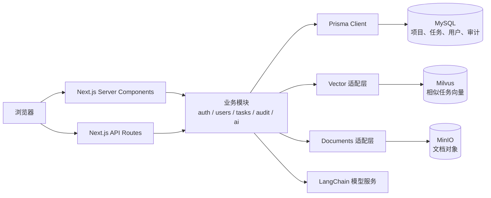

# MedPM-AI 项目详细说明

> 面向第一次参与本项目开发的阅读者。本文保留用户模块阶段的实现说明与历史验证。2026-10-16 的最新交付范围、项目隔离、文档/RAG、排期、风险调度及合规导出，以 [本地 PR 文稿](local-pr-delivery-workflows.md) 和其中链接的分模块说明为准。

> 本文主要实现基线：2026-10-14 的 `21dc16a`（用户模块 2b 完成）。下列历史测试数字与后续路线描述属于该阶段；最新审查及验收见 [2026-10-16 审查报告](code-review-2026-10-16.md)。

## 0. 用户模块阶段结论（2026-10-14）：闭环完成，整个平台仍处于 MVP 阶段

项目已具备“真实账号登录 → 按角色操作任务或管理用户 → 查看审计”的完整路径，不再依赖手工注入 Cookie 才能演示。用户模块的约定范围已完成并通过自动化验证，可进入人工验收；这不等于整个平台功能齐备或已经符合医疗软件生产使用要求。

| 能力 | 当前状态 | 证据与边界 |
|---|---|---|
| 注册、登录、登出、个人资料、改密 | 已完成本阶段 MVP | login、register、profile 页面及对应 API 已交付；真实数据库会话、锁定、Cookie 轮换已验证 |
| 管理员用户管理 | 已完成本阶段 MVP | `/users` 与四个管理 API；筛选分页、创建、角色/状态修改、本人和系统账号保护 |
| 任务与审计核心流程 | 已实现并验证核心路径 | 项目列表、任务看板、负责人分配、状态流转、需求/测试关联展示、审计时间线 |
| WBS、合规审计、风险预警 | 已有服务实现和基础界面 | 有规则、模型适配、建议持久化及基础 Panel；本轮未执行真实模型/向量链路的完整验收 |
| 文档上传、MinerU、文档 RAG | 尚未形成业务闭环 | 有 Document 模型、MinIO 封装、documents collection 定义；无完整上传/解析/检索交付流程 |
| 后台队列、统一导航、生产加固 | 待推进 | Redis 可选但未接队列；共享导航仅覆盖首页、profile、users；无本轮生产构建/部署验收 |

本阶段最终验证：**217 条单测、33 条真实 MySQL 集成测试、40 条 E2E 全部通过**，全量 E2E 耗时 **55.8 秒**。测试账号的 Session 清理已复查为 0，但测试账号及审计记录按约定保留。

用户模块没有包含删除账号、批量操作、用户自行编辑资料、密码找回、邮件/短信、OAuth/SSO、MFA；这些不能因本阶段完成而视为已实现。没有自动推进 AI Agent 前端或 2c。

## 1. 这个项目要解决什么问题

MedPM-AI 是医疗软件交付团队使用的项目协作和合规追溯平台。它围绕项目、需求、任务、测试和审计记录组织数据，并尝试把 AI 放进实际工作流：

1. **WBS 分解 Agent**：根据 PM 输入的合成需求和历史已完成任务，生成可逐条审阅的任务建议。
2. **合规审计 Agent**：检查任务、需求、测试用例和审计记录之间的追溯关系，并生成审计摘要。
3. **风险预警 Agent**：根据任务期限、人员负荷、前置任务和历史延期等规则提出风险提示。

AI 的定位是“提供建议”。建议默认待人工确认，不能绕过 PM 直接成为正式任务；风险 Agent 也不自动改变任务状态。项目只允许使用合成数据，不得录入真实患者信息（PHI）。

## 2. 用一张图看懂系统



**怎么理解这张图：**浏览器显示页面并发送请求；Server Component 和 API Route 在服务端检查身份、权限并读取数据，客户端不能直接访问数据库。业务模块实现规则，Prisma 负责读写 MySQL。只有 `src/modules/vector` 应直接依赖 Milvus SDK。对象存储由 `src/modules/documents` 封装。AI 任务建议先保存在建议表中，等待人工决定。

采用模块化单体是为了让业务变更、会话处理和审计容易保持事务一致，同时控制演示项目的部署成本。MySQL 是业务事实来源；Milvus 是检索辅助服务，失败时应退回 MySQL，不能决定正式任务是否存在。当前 users 模块明确分离 services/repositories；部分早期任务业务仍集中在 audit service 或 API 中，尚未完成全仓库统一分层。

## 3. 技术栈和常用命令

| 部分 | 当前使用 | 用途 |
|---|---|---|
| Web 页面和 API | Next.js 15 App Router、React 19、TypeScript | 页面 SSR、客户端交互、API Route |
| 样式 | Tailwind CSS；项目有 shadcn/ui 配置和少量 UI 组件 | 页面样式和组件基础 |
| 关系数据库 | MySQL 8、Prisma 6 | 用户、项目、任务、审计等关系数据 |
| 向量数据库 | Milvus 2.6 | WBS 历史任务的相似检索；文档 collection 也有初始化定义 |
| 对象存储 | MinIO | 文档对象存储的客户端封装 |
| AI 接入 | LangChain.js | OpenAI、Anthropic 或 Gemini 聊天模型，以及 OpenAI embedding |
| 测试 | Vitest、Playwright | 单元测试和浏览器端流程测试 |
| 本地服务 | Docker Compose | MySQL、Milvus、etcd、MinIO，Redis 为可选服务 |

仓库中的 `package.json` 命令：

```powershell
pnpm dev          # Next.js 开发服务器，端口 4000
pnpm build        # 生产构建
pnpm start        # 运行生产构建
pnpm lint         # ESLint 检查 src
pnpm typecheck    # TypeScript 类型检查
pnpm test         # Vitest 单元测试
pnpm test:integration:auth # Vitest 真实 MySQL HTTP 集成测试（当前也包含 users）
pnpm test:e2e     # Playwright 浏览器测试
pnpm db:generate  # 根据 Prisma schema 生成客户端
pnpm db:deploy    # 应用已有 migration
pnpm db:migrate   # 开发环境创建 migration（通常带 --name 名称）
pnpm db:seed      # 写入可重复执行的合成演示数据
pnpm vector:init  # 初始化 documents 向量 collection
```

本地开发服务由 `pnpm dev` 使用 `http://localhost:4000`。Docker Compose 中生产 app 容器暴露的是 `http://localhost:3000`。两种端口不同是正常的。`playwright.config.ts` 默认启动 4000 端口的开发服务器，也可以用 `E2E_BASE_URL` 指向已有服务器。

## 4. 目录导航：改功能时先去哪儿找

```text
src/
  app/                         页面和 API 路由（Next.js 入口）
    api/                       HTTP API；通常负责鉴权、Zod 校验、调用服务
    projects/                  项目列表和项目任务看板
    tasks/[taskId]/             任务详情页
    audit/                     审计查看页
    login/                     登录页：Server 身份判断 + Client 表单
    register/                  注册页：邀请码、密码确认、结果展示
    profile/                   个人资料、改密、登出
    users/                     ADMIN 用户管理界面
  components/
    auth/                      共用输入项、提示、提交按钮和页面外壳
    app-navigation.tsx         首页、profile、users 的共享导航
  modules/
    auth/                      密码、数据库会话、旧 Cookie 兼容、RBAC、表单规则
    users/                     管理规则、Zod 输入、repositories、错误响应
    audit/                     审计写入、审计过滤条件
    tasks/                     任务状态规则
    projects/                  项目模块说明（当前业务实现主要在 API/Prisma）
    ai/                        WBS、合规审计、风险提示和模型接入
    vector/                    Milvus 客户端、集合、历史任务检索
    documents/                 MinIO 客户端（文档处理仍不完整）
  lib/prisma.ts                全应用共享的 Prisma Client
prisma/
  schema.prisma                当前数据库结构的声明来源
  migrations/                  按时间顺序演进数据库的 SQL
  seed.mjs                     合成演示数据
tests/integration/             隔离 MySQL 库上的真实 HTTP 集成测试
e2e/                          auth、users、tasks 三份浏览器测试
docx/prompts/                  分阶段开发任务模板；认证任务见 10-注册登录用户管理.md
docs/known-issues.md           已知问题、优先级与 workaround
```

### 阅读代码时的常见分工

- `src/app/**/page.tsx`：页面入口；服务端页面可以直接查 Prisma，再把安全、必要的数据传给客户端组件。
- `src/app/**/route.ts`：API Route。一般先 `getCurrentUser()`，再用 `requireRole()`；输入通过 Zod；完成后用 `NextResponse.json()` 返回。
- `src/app/**/task-board.tsx` 等客户端组件：表单、按钮、fetch 调用和页面状态更新。
- `src/modules/**/service.ts`：跨页面可复用的业务流程和数据库事务。
- `src/lib/prisma.ts`：统一 Prisma Client。不要在每个 API 自己 `new PrismaClient()`。
- `prisma/schema.prisma`：数据库表和关系的主定义；migration 才是实际部署时的数据库变更脚本。

## 5. 当前有哪些页面和能力

| 路径 | 页面作用 | 当前实现情况 |
|---|---|---|
| `/` | 产品入口，链接到项目和审计 | 按服务端身份显示导航，保留 Agent 简介 |
| `/login` | 邮箱和密码登录 | 已登录直接回首页；本次登录成功才使用安全 next |
| `/register` | 自助注册 | 姓名、邮箱、两次密码、可选邀请码；成功留在当前页，不自动登录或跳转 |
| `/profile` | 当前账号维护 | 服务端验证数据库会话；展示资料、改密、登出 |
| `/users` | 管理员账号管理 | ADMIN 专用；筛选、分页、创建、改角色、激活/禁用 |
| `/projects` | 项目列表 | 服务端读取 MySQL 项目 |
| `/projects/[projectId]/board` | 项目任务看板 | 创建任务、查看任务、更新状态、PM 分配成员；有 WBS 和风险面板 |
| `/tasks/[taskId]` | 单个任务详情 | 显示状态、工时、关联需求/测试、前置任务和审计时间线 |
| `/audit` | 审计查看 | 筛选审计记录并触发合规摘要；仅 ADMIN/QA |

共享导航目前只接入首页、profile、users，ADMIN 才看到用户管理入口。看板、审计、任务详情尚未进行导航统一；早期项目页/看板的未登录提示也尚未统一为认证页面的重定向体验。已有 WBS/风险 Panel 和审计摘要入口，不代表后续 AI 前端完善阶段已经完成。

## 6. API 一览和权限

所有受保护的 API 都按服务端当前用户角色授权。客户端自己传入的角色不能代替服务端校验。

| API | 方法 | 当前角色要求 | 作用 |
|---|---|---|---|
| `/api/health` | GET | 匿名仅存活响应；详细检查仅 ADMIN | 匿名 `{status: "ok"}` 不代表依赖健康；ADMIN 检查 MySQL、Milvus、MinIO，其他已登录角色 403 |
| `/api/auth/register` | POST | 公开 | 无邀请码创建 PENDING；有效邀请码创建 ACTIVE；不自动建立会话 |
| `/api/auth/login` | POST | 公开 | 验证密码和状态，处理失败计数/锁定，创建数据库 Session |
| `/api/auth/logout` | POST | 当前 Cookie；允许重复登出 | 撤销当前会话、写审计、清 Cookie；不会登出其他设备 |
| `/api/auth/me` | GET | 任意有效登录用户 | 当前账号安全资料，共用 getProfileForUser |
| `/api/users/me/password` | PATCH | 有效数据库会话 | 本人改密、轮换当前 Cookie、撤销其他 Session |
| `/api/projects` | GET | 任意已认证角色 | 返回项目列表 |
| `/api/projects/[projectId]/tasks` | GET | 任意已认证角色 | 返回项目任务及负责人、需求、依赖 |
| `/api/projects/[projectId]/tasks` | POST | ADMIN、PM | 创建任务并写 `TASK_CREATED` 审计 |
| `/api/tasks/[taskId]` | GET | 任意已认证角色 | 查询任务详情数据和审计记录的 API 形式 |
| `/api/tasks/[taskId]` | PATCH | ADMIN、PM、MEMBER | 改状态；PM 可分配负责人；MEMBER 只能操作分配给自己的任务 |
| `/api/users/options` | GET | ADMIN、PM | 仅 ACTIVE 非系统账号的 id/name/email，供 PM 看板负责人下拉使用 |
| `/api/users` | GET | ADMIN | 角色、状态、关键词筛选及分页；排除系统账号 |
| `/api/users` | POST | ADMIN | 创建 ACTIVE 非系统用户，初始密码哈希保存并写审计 |
| `/api/users/[id]/role` | PATCH | ADMIN | 修改他人角色；禁止本人和系统账号；记录 before/after |
| `/api/users/[id]/status` | PATCH | ADMIN | 激活、禁用、重新启用他人；禁用撤销有效 Session 并写审计 |
| `/api/audit` | GET | ADMIN、QA | 按项目、人员、操作和时间过滤审计记录 |
| `/api/audit/summary` | POST | ADMIN、QA | 运行项目追溯检查并生成/降级为规则摘要 |
| `/api/projects/[projectId]/ai/wbs` | GET、POST | PM | 列出待确认 WBS 建议；根据输入生成建议 |
| `/api/ai/wbs/[suggestionId]` | PATCH | PM | 接受或拒绝一条 WBS 建议 |
| `/api/projects/[projectId]/ai/risk` | GET、POST | PM | 查看待处理风险并触发规则扫描 |
| `/api/ai/risk/[suggestionId]` | PATCH | PM | 标记风险已处理或忽略 |

### 权限错误是什么意思

- `401 Authentication required`：没有有效会话 Cookie。
- `403 Forbidden`：已识别出用户，但该角色不能执行此操作。
- 请求体错误一般返回 `400`；找不到资源常见为 `404`；冲突或状态不可转换常见为 `409`。

权限仍是全局角色 RBAC，当前不能视为已实现项目成员级授权、多租户隔离或完整 ABAC。ADMIN 能查看管理数据，不表示每个早期业务操作都开放给 ADMIN，例如现有任务负责人分配仍由 PM 执行。

## 7. 数据库：表、关系和重要规则

数据库声明在 `prisma/schema.prisma`，数据库是 MySQL。ID 使用 UUID 字符串，时间字段使用 UTC 的 `DATETIME(3)`，业务变化应通过 migration 演进。

### 13 个 Model

| Model | 用途 | 重要关系/字段 |
|---|---|---|
| `User` | 用户、角色、状态 | `role`、`status`、可空 `passwordHash`、`isSystem`、登录失败与锁定字段 |
| `Session` | 已接入认证链路的数据库会话 | `tokenHash`、过期/撤销时间、IP 和 User Agent；支持多设备和服务端失效 |
| `PasswordResetToken` | 预留的密码重置令牌 | 只存 token hash、失效/使用时间 |
| `Project` | 项目 | 可选负责人，拥有任务、需求、文档、建议、审计记录 |
| `Task` | 正式工作项 | 状态、负责人、需求、工时、期限、完成时间 |
| `TaskDependency` | 任务前置依赖 | 连接任务与其前置任务 |
| `Requirement` | 项目需求 | 版本、状态、正文；可关联多个任务和测试用例 |
| `TestCase` | 需求测试用例 | 状态从 `NOT_RUN` 等枚举中选择 |
| `AIRecommendation` | 早期版本遗留的建议表 | 保留兼容用途；当前 Agent 主要使用 `AiSuggestion` |
| `AiSuggestion` | WBS/风险等待审阅建议 | 输入和输出为 JSON，带类型、状态、审核人 |
| `AuditLog` | 不可变审计事件 | actor、action、entity、before/after、project、IP、UA、时间 |
| `Document` | 项目文档元数据 | MinIO object key、文件名、解析文本 |
| `SyncFailure` | 外部同步失败重试记录 | 失败目标、payload、错误、retryCount |

### 9 个 Enum

| Enum | 值 |
|---|---|
| `Role` | `ADMIN`, `PM`, `MEMBER`, `QA` |
| `UserStatus` | `ACTIVE`, `DISABLED`, `PENDING` |
| `ProjectStatus` | `PLANNING`, `ACTIVE`, `ON_HOLD`, `COMPLETED` |
| `TaskStatus` | `TODO`, `IN_PROGRESS`, `BLOCKED`, `DONE` |
| `RequirementStatus` | `DRAFT`, `IN_REVIEW`, `APPROVED`, `RETIRED` |
| `TestCaseStatus` | `NOT_RUN`, `PASSED`, `FAILED`, `BLOCKED` |
| `AIRecommendationStatus` | `PENDING_CONFIRMATION`, `ACCEPTED`, `REJECTED` |
| `AiSuggestionStatus` | `PENDING`, `ACCEPTED`, `REJECTED` |
| `AiSuggestionType` | `WBS`, `ESTIMATE`, `RISK`, `AUDIT_SUMMARY` |

### 关系的直观版本

```text
User ──拥有──> Project ──包含──> Task
                         ├────> Requirement ──包含──> TestCase
                         ├────> AiSuggestion
                         ├────> Document
                         └────> AuditLog
Task ──可关联──> Requirement
Task ──TaskDependency──> 前置 Task
AuditLog ──actorId──> User
```

### 为什么审计写入要和业务修改放在一个事务里

比如“开始任务”要同时把 `Task.status` 从 `TODO` 改成 `IN_PROGRESS`，并插入 `TASK_STATUS_CHANGED` 审计。如果只改任务而审计写失败，就会产生无法追溯的业务变化。因此服务层在同一个 Prisma transaction 中完成二者：任一写入失败，整笔事务回滚。数据库 trigger 还会拒绝直接更新或删除 `AuditLog` 行。

## 8. 迁移文件按什么顺序演进

| Migration | 主要变化 |
|---|---|
| `20261011000000_init` | 最初的 User、Project、Task、旧 AIRecommendation、AuditLog、Document 等表 |
| `20261012000000_core_data_model` | 扩充项目、任务、文档字段；增加需求、测试用例、建议、同步失败模型 |
| `20261012010000_rbac_audit_scope` | 审计按项目筛选；回填已知业务记录的 projectId；增加审计不可变 trigger |
| `20261012020000_wbs_agent` | 任务实际工时、完成时间和任务依赖表 |
| `20261013000000_auth_users_sessions_tokens` | 用户密码/状态/系统账号字段、Session 和密码重置 token 表 |

每个阶段有 `migration.sql`；早期阶段也有 `down.sql` 作为人工回滚参考。Prisma 不会自动运行这些 `down.sql`。迁移已部署后，不要直接改旧 migration；要新建 migration 修正结构。

## 9. 用户模块：已闭环的业务与安全设计

### 9.1 注册、登录和资料读取

- 注册校验姓名、邮箱、密码强度与 bcrypt 的 72 UTF-8 字节上限。确认密码仅在前端核对，不发送给后端；密码原值不 trim。
- 邀请码先 trim 再发送；空白时省略字段。后端也兼容空字符串。无邀请码为 PENDING，有效邀请码为 ACTIVE；页面依据返回状态展示结果，不自动登录或跳转。
- 注册成功但 status 未识别时保留全部输入，提示“无法确认注册结果，如果账号已创建，请直接登录”，并提供登录入口；不会自动重发请求。
- 登录错误邮箱/密码统一提示；PENDING 提示等待激活；DISABLED 拒绝。连续失败达到 5 次锁定 15 分钟，锁定期间重试不会延长锁定。
- `src/modules/auth/profile.ts` 的 `getProfileForUser(userId)` 返回 id、email、name、role、status、lastLoginAt；API me 和 Profile Server Component 共用。调用方先验证身份，只能传入服务端确认的当前用户 ID。

### 9.2 会话、改密和登出

新登录使用数据库支持的签名凭据，包含 sessionId、userId、随机 secret 和过期时间。Session 表只保存 tokenHash，不保存明文凭据。`medpm_session` Cookie 使用 HttpOnly、SameSite=Lax、生产 Secure，TTL 为 8 小时。

认证会核对数据库 Session 的 tokenHash、过期/撤销状态以及 User.status；角色从数据库读取，不信任浏览器传来的 role。`getCurrentUser()` 还保留临时旧签名 Cookie 兼容路径，现已补充 ACTIVE 检查：真实数据库测试证明同一枚旧 Cookie 在账号禁用后访问受保护 API 返回 401。旧兼容路径不应被当成具有数据库 Session 全部生命周期能力，后续需要明确退役窗口。

改密成功保留当前 Session.id，但轮换 secret/tokenHash，撤销其他未撤销 Session，并写 PASSWORD_CHANGED。浏览器自动接收 Set-Cookie；前端清空三个密码框，留在页面显示“密码已更新，当前设备保持登录，其他设备需要重新登录”。另一设备保留原 Cookie，但下一次请求会被拒绝；不意味着已经显示的页面被远程关闭。

登出撤销当前 Session 并写 LOGOUT，成功后清 Cookie、完整跳转登录页；失败保留重试能力，页面不假装已登出。登录会惰性清理该用户的过期 Session，尚无全局定时清理任务。

### 9.3 页面边界与安全跳转

login、register、profile、users 的 page 为 Server Component，负责身份/权限、初始数据和重定向；表单、弹窗、loading、防重复提交为 Client Component。数据库异常显示“暂时无法加载，请重试”，与未登录返回 null 区分；redirect 放在数据库 try-catch 外。

未登录访问 profile/users 分别跳 `/login?next=/profile`、`/login?next=/users`。next 必须以 `/` 开头、不以 `//` 开头，不含冒号或反斜杠；检查编码/规范化后的地址并排除 login/register 循环，失败回退 `/`。已登录访问 login/register 直接回首页，忽略 next。本次登录成功用 `location.replace` 完整加载目标页，让服务端重新读取身份。

密码不放进 URL、localStorage 或 sessionStorage。字段错误显示在输入框下，账号/网络错误显示在表单区域；提交中禁用操作并用提交锁防重复。profile 的改密与登出共用锁，避免 Cookie 轮换与登出并发。

### 9.4 管理员用户管理与审计

PM 不再读取完整用户管理列表；任务下拉通过 options 获取 id/name/email，email 用于区分同名用户，属于内部半公开信息。options 固定过滤 `isSystem=false AND status=ACTIVE`。管理列表排除系统账号，支持 role/status/keyword；page 默认 1，pageSize 默认 20、最大 100，列表和总数使用同一查询条件与稳定排序。

管理员设置初始密码，创建结果固定为 ACTIVE、非系统用户。本人角色/状态及系统账号禁止修改，前端和服务端分别拦截。状态支持 PENDING→ACTIVE、ACTIVE→DISABLED、DISABLED→ACTIVE，不提供删除或改回 PENDING。

写入服务在事务内以参数化 SQL 锁定操作者/目标行，再 findUnique 重查权限和当前状态；不引入 expectedStatus。条件写入失败、重复或非法状态转换返回 409：“账号状态已变化，请刷新”。这能判断当前转换是否合法，但不能识别所有过期页面意图；重新启用一个当前 DISABLED 用户本身仍是合法操作。

禁用通过 `where: { userId, revokedAt: null, expiresAt: { gt: now } }` 撤销有效 Session。审计 `after.revokedActiveSessionCount` 取 updateMany 的影响行数：5 条中 2 条过期，计数为 3。重新启用不会恢复被撤销的数据库 Session。

| action | actorId / entityId | before / after |
|---|---|---|
| USER_CREATED_BY_ADMIN | 管理员 / 新用户 | before 为空；after 记录 ID、脱敏邮箱、角色、ACTIVE |
| PERMISSION_CHANGED | 管理员 / 目标用户 | 原角色 / 新角色 |
| USER_STATUS_CHANGED | 管理员 / 目标用户 | 原状态 / 新状态、撤销有效 Session 数 |

认证另有 USER_REGISTERED、LOGIN_SUCCESS、LOGIN_FAILED、LOGOUT、PASSWORD_CHANGED 等记录。审计保留 IP、userAgent 和 UTC 时间，不包含明文密码或 passwordHash。管理变更、Session 撤销、审计共同提交；真实数据库故障注入测试已验证回滚。

## 10. 三个 AI Agent 是怎么工作的

### WBS 分解 Agent

1. PM 在看板输入需求，并确认只使用合成数据。
2. API 对输入做 Zod 校验和有限的敏感信息模式检查。
3. 服务先检索本项目已完成且记录实际工时的历史任务：Milvus 可用时做向量检索；Milvus 不可用或没有匹配时退回 MySQL 关键词检索。
4. 调用配置的聊天模型，校验返回的 JSON 结构。
5. 将生成结果放进 `AiSuggestion`，状态是 `PENDING`；生成过程和检索来源写审计。
6. PM 逐条接受/拒绝。接受任务建议时才创建正式 `Task`；如果有前置建议，须先接受前置项。

没有模型配置、模型失败或返回格式不合规时，服务记录失败并提供人工创建任务的降级路径。AI 输出绝不应被当成已确认业务事实。

### 合规审计 Agent

它读取有限范围的项目审计、任务、需求和测试数据，规则会提示：已完成任务关联的测试缺失/未通过；需求更新晚于关联任务更新等情况。然后模型可以把发现整理成摘要，但它不能引用输入数据之外的审计 ID 或业务记录 ID。模型不可用时返回规则结果，并把本次扫描和降级模式写入审计。

访问入口是 `/audit` 页面和 `POST /api/audit/summary`，当前只允许 ADMIN/QA。

### 风险预警 Agent

由 PM 手动触发，不会后台自动扫描或改任务。当前规则关注：7 天内到期但仍 TODO 的任务、短期内成员未完成任务负荷过高、未完成前置任务，以及有足够历史样本时的延期率。风险建议进入 `AiSuggestion` 待处理状态；PM 标记处理/忽略会写审计。

### 向量和文档边界

- Milvus 的 Task History collection 用 1536 维向量，服务端按 projectId 过滤。
- `src/modules/vector` 封装 SDK，AI 业务服务不应直接导入 Milvus SDK。
- `documents` collection 初始化代码已经存在，但当前文档上传、MinerU PDF 解析的完整业务流程还没有实现。
- MinIO 客户端封装和 Docker 服务存在，不代表页面/API 的上传功能已经完成。
- Redis 在 Compose 里是 `async` profile 可选服务，目前没有看到已接入的队列工作流。

### 当前 AI 能力的验收边界

风险模块当前是确定性规则扫描，不调用 LLM，也没有后台调度。WBS/合规摘要有模型适配和结构校验，但当前 40 条 E2E 主要验证账号、管理和任务流程，不能作为真实 LLM 质量或 Milvus 效果的验收依据。敏感信息正则检查只是有限拦截，不构成 PHI 检测保证或合规认证。

向量同步失败已有 SyncFailure 留存及后续关键词回退时的有限重试，不等于完成了可观察的后台重试队列。事务回滚能防止 AI 采纳写入一半，当前没有已采纳建议“一键撤回”的完整业务流程。电子签名、21 CFR Part 11、GxP 正式验证、合规导出交付也尚未完成；存在 DATA_EXPORTED 审计封装不等于已有导出功能。

## 11. 关键业务流程：创建任务、更新状态

### 创建任务

```text
看板表单
  → POST /api/projects/{projectId}/tasks
  → 验证 Cookie 和 ADMIN/PM 权限
  → Zod 校验标题/需求 ID
  → audit service 在 transaction 内创建 Task + TASK_CREATED AuditLog
  → 返回 201
  → 浏览器重新 GET tasks
  → 更新看板显示
```

### 改状态

```text
看板状态按钮
  → PATCH /api/tasks/{taskId}
  → 服务端检查角色、任务当前状态和允许的转换
  → transaction 内更新 Task + 写 TASK_STATUS_CHANGED
  → 返回更新结果
  → 浏览器重新载入看板
```

完成任务时要求实际工时大于零。MEMBER 只能改分配给自己的任务，且不能自行重新打开 DONE 任务；PM/ADMIN 可重新打开。每次成功修改都应对应一条可追溯审计。

## 12. 环境变量和本地启动

配置名见 `.env.example`。`.env.example` 中只是示例；请在本机 `.env` 填写自己的值，不要把真实密钥提交到 Git。

| 变量 | 用途 | 是否当前必要 |
|---|---|---|
| `DATABASE_URL` | Prisma 连接 MySQL | 必需 |
| `SESSION_SECRET` | 签名登录 Cookie，至少 32 bytes | 受保护页面/API 必需 |
| `AI_PROVIDER`、`AI_MODEL` | 选择聊天模型 | 使用真实模型时需要 |
| `OPENAI_API_KEY` 等模型 Key | 模型鉴权；OpenAI embedding 用于向量检索 | AI 功能需要；未配置时有部分降级路径 |
| `MILVUS_ADDRESS`、`MILVUS_TOKEN` | Milvus 地址/令牌 | 向量检索需要；可降级 |
| `MINIO_ENDPOINT`、`MINIO_PORT`、`MINIO_ACCESS_KEY`、`MINIO_SECRET_KEY`、`MINIO_BUCKET` | MinIO 对象存储 | 文档存储时需要 |
| `LOCAL_DEV_SEED_PASSWORD` | 本地 seed 测试用户密码 | 运行 seed 时需要 |
| `REGISTRATION_INVITE_CODE` | 自助注册激活邀请码 | 本地注册可选；有效邀请码 E2E 用例需要，Playwright 显式传给 webServer |
| `MYSQL_ROOT_PASSWORD` | 集成测试创建/销毁隔离数据库 | 本地真实 DB 集成测试需要；不用于普通业务 API |
| `E2E_BASE_URL` | Playwright 复用已有服务 | Windows 推荐 workaround、CI 预启动服务时使用 |
| `REDIS_URL` | Redis 连接 | 当前主流程可选 |

一个常见的本机启动顺序：

```powershell
if (!(Test-Path .env)) { Copy-Item .env.example .env }
# 编辑 .env：数据库、随机 SESSION_SECRET、测试密码和可选邀请码
docker compose up -d mysql etcd minio milvus
pnpm install
pnpm db:generate
pnpm db:deploy
# 确保 seed 进程的 LOCAL_DEV_SEED_PASSWORD 与本机 .env 中的值一致
pnpm db:seed
pnpm dev
```

然后打开 `http://localhost:4000/login`。本地 seed 账号为 admin、pm、member、qa、pending、disabled 六个 `@medpm.local` 账号，例如 `admin@medpm.local`；初始密码来自 LOCAL_DEV_SEED_PASSWORD，改密后使用新密码。重复 seed 不等于重置已有账号密码或清空测试数据。

健康检查 `/api/health`：匿名只返回存活响应；ADMIN 登录后可看详细 checks，依赖异常/未配置时详细响应为 degraded（503）；其他已登录角色返回 403。不能把匿名 ok 当成 MySQL/Milvus/MinIO 全部通过。

Windows 若 PowerShell 阻止 pnpm.ps1，可使用等价的 `pnpm.cmd`。不要为了启动而全局关闭执行策略。Compose app 暴露 3000 端口且只显式传递配置中列出的变量；当前没有显式传递邀请码和模型 Key，不能假设宿主机 .env 自动全部进入容器。容器环境和生产 Cookie/HTTPS 需要单独验收。

所有账号仅用于合成演示；不得把真实患者信息写入 seed、表单、AI prompt、日志或测试数据。

## 13. 测试证据、执行方式与边界

以下是用户模块 2b 最终验证记录（代码基线 21dc16a），不是本次文档编辑新跑出的 DB/E2E 数字：

| 层次 | 结果 | 验证对象 |
|---|---|---|
| lint / typecheck | 全部通过 | src 的 ESLint、额外 E2E/集成文件 lint、TypeScript strict |
| mock/单测 | 31 个文件，217/217 | 输入、RBAC、页面身份分支、服务规则、审计与降级等 |
| 真实 MySQL HTTP 集成 | 4 个文件，33/33；61.42 秒 | register 6、login 8、session 10、users 9 |
| Playwright E2E | 3 个文件，40/40；55.8 秒 | auth 28、users 11、tasks 1 |

真实数据库测试创建独立临时库，部署现有 migration，通过真实 HTTP 验证事务、Session 和审计；失败审计注入触发器只存在于隔离库，测试后销毁该测试库，不对开发业务库执行 reset。测试命令名 `test:integration:auth` 沿用历史命名，但配置现在也包含 users。

关键通过项包括：旧 Cookie 对禁用账号返回 401；改密前捕获第二个 context 的 Cookie，改密后不重新登录，旧凭据返回 401、当前设备继续有效；禁用只计有效 Session；并发禁用只有一次成功和一条审计；审计失败整体回滚；降权后的管理员旧页面不能继续创建账号；PM 看板通过 options 真正分配负责人并出现 TASK_ASSIGNED。

Windows 建议按以下方式运行浏览器测试（两个终端）：

```powershell
# 终端 A：预先启动并等待服务就绪
pnpm.cmd dev

# 终端 B：与服务使用一致的数据库、SESSION_SECRET、测试密码、邀请码
$env:E2E_BASE_URL = "http://localhost:4000"
pnpm.cmd test:e2e
```

CI 使用该 workaround 时也必须预启动服务、等待就绪并负责结束清理。全局 workers 未固定为 1；最后全量运行使用 3 个 worker，auth/users spec 内串行，测试间使用独立账号。auth/users 的 afterAll 清理自身 Session；测试账号和不可变审计保留，任务 spec 仍可能积累 Session。

本轮没有重新验收生产 build、Docker 全链路、真实模型回答质量或文档解析。任务详情 E2E 仍用 page.goto 直接加载，不能把该断言扩展成已证明所有客户端链接导航均正常。

## 14. 当前已知差异与正在排查的问题

已知问题的详细记录以 [known-issues.md](known-issues.md) 为准：

| 状态 | 问题 | 当前判断/处理 |
|---|---|---|
| P2，历史间歇问题 | 任务列表 GET 曾返回 500 | 最近回归未复现，不能宣称根因已修复；历史 Watchpack/JSON 错误也不能无证据归为同一原因 |
| P3 | 邀请码直接比较的理论时序侧信道 | MVP 已记录；生产前评估定时安全比较 |
| P3 | 重复邮箱注册响应时间差、PENDING 登录提示可枚举邮箱 | 保持当前确认的交互，生产前评估速率限制和提示策略 |
| P3 | 测试账号和部分 Session 积累 | auth/users 清自身 Session；账号保留审计关联；reset 只用于可丢弃测试库 |
| P3 | Windows Playwright dev server 偶发关闭卡住 | 用 E2E_BASE_URL 复用预启动服务，由启动方关闭；CI 同样需预启动 |

本阶段已修复的问题：旧 Cookie 路径缺少 ACTIVE 检查；看板人员列表未拆分；options 的系统/非激活账号过滤；用户管理下拉框标签混入选项文本。故障注入测试创建触发器需使用 Prisma db execute 而不是预处理查询，这属于已修复的测试设施问题。

文档也有历史债务：根 README 和部分模块 README 仍保留初始骨架说明，含“认证未实现”等过期叙述；本次仅更新本文件。旧文档中“当前含大量 TaskBoard 临时日志”的说法已不符合本次代码搜索结果，不再当成当前故障。User.passwordHash 仍可空以兼容历史数据，后续需回填并评估改为必填。

## 15. 作为新手，推荐按这个顺序熟悉代码

1. 先看本文件的第 2、4、6 节，理解目录和请求入口。
2. 看 `prisma/schema.prisma`，找到页面涉及的数据表；再看 `prisma/seed.mjs`，理解演示数据。
3. 从看板开始追一次请求：`src/app/projects/[projectId]/board/task-board.tsx` → 对应 `src/app/api/.../route.ts` → `src/modules/audit/service.ts` → `src/lib/prisma.ts`。
4. 从 login/profile/users 页面追到 auth/session.ts、auth/profile.ts 和 users/services.ts，理解身份、资料与账号管理的边界。
5. 看 `src/modules/ai/README.md` 及对应 Agent service，再看 API Route 和看板上的 Panel。
6. 修改数据库时同步更新 Prisma schema 和新增 migration；不要只改 schema，也不要篡改已经部署的旧 migration。
7. 每次修改按仓库约定跑 lint、typecheck、test；改认证或管理事务时补真实 DB 验证，改交互时补 E2E。生产交付另做 build、容器和 migration 验收，不能把开发服务器通过等同于生产通过。

## 16. 当前成熟度与建议下一步

用户模块最有价值的成果是把“账号状态、权限、会话撤销、审计”连成可验证的工作流：禁用不是改一个标签，审计也不是事后 console.log。失败时通过事务回滚或明确重试提示保持一致，这是医疗交付场景与普通演示 CRUD 的主要区别。

平台已经具备作品集演示基础，但暂不宜用百分比宣称“整个项目完成”。三个 Agent、文档处理、项目/需求/测试的编辑能力、统一交互和生产运维，各自的成熟度不同，应分别验收。

建议后续按以下优先级讨论，以下仅为路线建议，未开始执行：

1. **人工验收用户闭环。** 用合成 ADMIN/PM/MEMBER/QA 账号复核注册待激活、管理员激活、角色变化、双设备改密、禁用与审计，形成可复现演示脚本。
2. **统一导航和认证体验。** 接入其余业务页，补客户端导航覆盖，明确旧 Cookie 退役窗口，集中处理 README/模块说明的过期内容。
3. **明确 AI 前端与评估范围。** 在已有基础面板上完善来源、降级、人工确认与处理反馈，并以真实模型/向量场景验证；未配置模型时仍应能演示人工任务和规则审计。
4. **补文档和追溯业务闭环。** 将上传、MinerU、解析失败、对象/关系/向量关联和可重试流程逐项落实，不把存储封装当成完成。
5. **生产交付与合规验证。** 复核容器变量、HTTPS/Cookie、迁移回滚、监控备份、速率限制、数据保留及签名/导出要求，分别出验证证据。

作为 FDE 作品集，讲解重点应是业务约束如何影响技术选择：为什么拆人员选项和管理列表、为什么审计失败必须回滚、为什么风险扫描先采用可解释规则、为什么向量失败能降级，以及每项“通过测试”的结论究竟覆盖到哪里。

### 最后记住四条

- API/服务端才是权限可信边界，不要信任浏览器传来的 role。
- 业务写入与审计记录应在同一事务中。
- AI 输出是待确认建议，不是正式业务数据。
- 任何演示和测试内容都必须是合成数据，绝不放真实患者信息。
